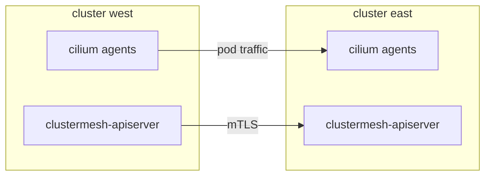

# What Cluster Mesh Connects And What It Requires

Two Kubernetes clusters are two separate systems. A pod in one cluster has no route to a pod in the other, a Service in one cluster does not exist in the other, and a network policy in one cluster knows nothing about the pods of the other. Cluster Mesh is the Cilium feature that removes these limits for networking while the clusters stay separate Kubernetes installations. This part explains what Cluster Mesh connects, why that is useful, and the conditions that must hold in every cluster before a connection can work.

## What Cluster Mesh connects

Cilium is a networking plugin. In each cluster it runs an agent on every node, and the agent gives each pod an address, enforces policy and balances traffic to Services. Cluster Mesh lets the agents of several clusters learn about each other's pods and Services. After that, an agent can treat a pod in a remote cluster as a valid destination.

The benefits follow directly from that one ability:

- A pod can reach a pod in another cluster by its pod IP address, with no gateway and no address translation in between.
- A Service can have backends in several clusters, so one name can be answered by pods from any of them.
- A network policy can name the cluster that a source pod runs in.
- Each cluster keeps its own API server, its own scheduler and its own failure domain. A failure of one control plane does not stop traffic that already flows.

Cluster Mesh does not copy Deployments, ConfigMaps, Secrets or application data between clusters. It exchanges networking state only: endpoints, identities and Service backends.

## The parts of a mesh

Each cluster that joins a mesh runs one extra component, the `clustermesh-apiserver`. It is a Deployment in the `kube-system` namespace with three containers. One container runs a small etcd database (a key-value store) that holds the state of this cluster that others may read. One container is the apiserver that writes that state into the database. The third, `kvstoremesh`, is a local cache that reads the databases of the remote clusters.



The diagram shows two paths. The control path connects the `clustermesh-apiserver` of each cluster over mutual TLS (a connection in which both sides prove their identity with certificates). The data path carries pod traffic directly between nodes.

The `clustermesh-apiserver` is exposed through a Kubernetes Service of type `LoadBalancer` or `NodePort`. The agents of the other cluster connect to that address. Pod traffic never passes through the `clustermesh-apiserver`. If it stops, existing connections keep working and the data already learned is kept.

## One trust domain

All clusters that are connected form one trust domain. Cilium gives each group of pods with the same labels a numeric security identity, and the policy decision is made from that identity. In a mesh the identities are shared across clusters, so a policy can allow or deny a pod from a remote cluster by its labels.

The consequence is that a connection grants real reach. If a cluster in the mesh is compromised, its pods can send traffic to the other clusters, and only network policy limits what that traffic can touch. Connect only clusters that you are willing to put in the same trust domain, and write policy for the traffic that arrives from remote clusters.

## Prerequisites in every cluster

A connection fails or misbehaves if one of these conditions is false:

- **A unique cluster name.** At most 32 characters, lowercase letters, digits and dashes. The name appears in labels, in Hubble data and in the configuration of the remote clusters.
- **A unique cluster ID.** A number from 1 to 255. Cilium uses it to build identities and to tell clusters apart. A larger limit of 511 clusters exists, but it is an install-time setting that must be the same in all clusters.
- **Non-overlapping pod address ranges.** Each pod IP address must belong to exactly one cluster. Cluster Mesh routes by address.
- **Node-to-node connectivity.** Nodes of one cluster must reach the internal IP addresses of the nodes of the other cluster. Pod traffic crosses that network, either encapsulated in a tunnel or routed natively.
- **The same datapath mode in all clusters.** Either all clusters use tunneling or all use native routing.
- **A shared certificate authority.** The certificates of the `clustermesh-apiserver` and of the agents must be signed by a certificate authority (CA) that the other clusters trust. The simplest way is one CA for all clusters.
- **Compatible Cilium versions.** The clusters should run the same minor version of Cilium, or versions that are one minor release apart during an upgrade.

Changing the name or the ID of an existing cluster changes the identities of its pods. Cilium requires that the workloads are restarted afterwards.

<!-- astrona:playground:renew -->

## Read the prerequisites in the playground

Open a shell in the playground. The shell uses the context of the cluster `west`. The second cluster, `east`, is reached through a context whose name is in an environment variable. Save both names:

```sh
export WEST="$(kubectl config current-context)"
export EAST="$ASTRONA_CLUSTER_EAST_CONTEXT"
```

Read the cluster name and the cluster ID of both clusters from the Cilium configuration:

```sh
for context in "$WEST" "$EAST"; do
  kubectl --context "$context" -n kube-system get configmap cilium-config \
    -o jsonpath='{.data.cluster-name}{" "}{.data.cluster-id}{"\n"}'
done
```

The two lines must differ in both values. In this playground the names are `west` with ID 1 and `east` with ID 2.

Compare the pod address range of the node of each cluster:

```sh
for context in "$WEST" "$EAST"; do
  kubectl --context "$context" get nodes -o jsonpath='{.items[0].spec.podCIDR}{"\n"}'
done
```

The two ranges must not overlap.

## Common pitfalls

- Treating a successful `cilium clustermesh connect` as proof that pods can talk. The control path can be healthy while the data path is blocked by a firewall or a missing route.
- Giving two clusters the same name or the same ID because they were created from one template.
- Using a different certificate authority per cluster without telling Cilium to trust the others.
- Expecting Cluster Mesh to copy Deployments or data. It shares networking state only.

> [!WARNING]
> Cluster name and cluster ID are not cosmetic. Changing them later changes the security identity of every pod in the cluster, so plan them before the first workload runs.
