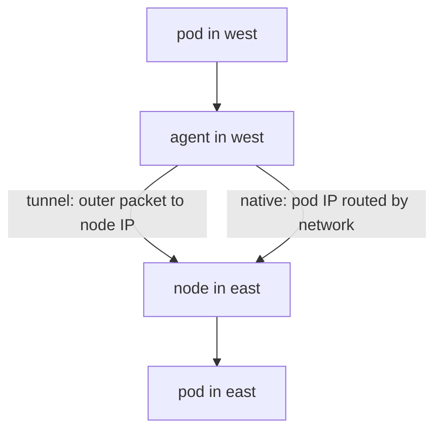

# Network Ports And Routing Modes Between Clusters

A mesh needs two kinds of network path between clusters. The control path lets the agents read the state of the remote clusters. The data path carries the packets of pods. Both paths cross the network between the nodes of the clusters, so a firewall or a missing route can break a mesh even when every name, ID and certificate is correct. This part lists the paths, the ports they use and the way the routing mode of Cilium changes what the network must provide.

## The control path

The control path ends at the `clustermesh-apiserver` of the remote cluster. A Kubernetes Service of type `NodePort` or `LoadBalancer` exposes it, and the agents of the other cluster connect to the address of that Service. The protocol is the etcd client protocol over mutual TLS, and the Service port is 2379 inside the cluster. With a `NodePort` Service the remote agents use the node port instead, which Kubernetes assigns from its node port range.

Two things follow from this. The node IP address and the node port (or the load balancer address) must be reachable from the nodes of the other cluster. A firewall between the clusters must allow that port. If the port is blocked, `cilium clustermesh status` reports that the remote cluster is not ready, and the pods of the two clusters do not see each other.

## The data path

The data path depends on the routing mode of Cilium. Cilium has two modes.

In tunnel mode, the default, Cilium wraps each pod packet in an outer packet that goes from node to node. The tunnel protocol is VXLAN (Virtual Extensible LAN, UDP port 8472) or Geneve (Generic Network Virtualization Encapsulation, UDP port 6081). The network between the clusters only has to carry the outer packets between node IP addresses. It does not need to know the pod address ranges.

In native routing mode, Cilium sends the pod packet to the network without an outer packet. The network must know how to deliver a packet for a pod address range of the other cluster to the right node. You provide that with routes, a routing protocol or a cloud network feature. Each cluster must also allow packets with a pod source address to leave its nodes, which a cloud provider's source and destination check may block.



The diagram shows that both modes end at the node of the destination pod. They differ in what the network between the nodes must understand.

## Ports and protocols between nodes

Beyond the tunnel port, Cilium needs health checks between nodes. The Cilium agents probe each other through the `cilium-health` endpoint and report the result in `cilium status`. For a mesh, allow the following traffic between the nodes of all clusters:

- UDP 8472 for VXLAN, or UDP 6081 for Geneve, when the tunnel mode is used.
- TCP 4240 for the health check of the agents.
- ICMP echo request and reply, which the health check also uses.
- The node port or the load balancer port of the `clustermesh-apiserver`.
- UDP 51871 when WireGuard transparent encryption is on.

A mesh can run without the health ports, but the agent then reports unreachable nodes and the status of the mesh shows warnings. Allow them from the start.

## Encryption and the mesh

Transparent encryption protects pod traffic between nodes. Cilium supports WireGuard and IPsec. With Cluster Mesh, both kinds of node must be able to establish encrypted tunnels to the nodes of the other cluster, so the encryption settings must match in every cluster. The mesh itself does not turn encryption on. The control path is encrypted with mutual TLS in every case.

<!-- astrona:playground:renew -->

## Read the routing mode of the playground

Open a shell in the playground and save the context names:

```sh
export WEST="$(kubectl config current-context)"
export EAST="$ASTRONA_CLUSTER_EAST_CONTEXT"
```

The agent reads the routing mode from the ConfigMap `cilium-config`. Read the keys that matter for the data path in each cluster:

```sh
kubectl --context "$WEST" -n kube-system get configmap cilium-config -o json | jq -r '.data | {"routing-mode": .["routing-mode"], "tunnel-protocol": .["tunnel-protocol"]}'
kubectl --context "$EAST" -n kube-system get configmap cilium-config -o json | jq -r '.data | {"routing-mode": .["routing-mode"], "tunnel-protocol": .["tunnel-protocol"]}'
```

Both clusters must show the same routing mode. A key that is absent shows as `null`, which means that the agent uses its default.

Next, check that the agents of a cluster can see their own nodes through the health endpoint. The health check is the first sign that node-to-node traffic works:

```sh
kubectl --context "$WEST" -n kube-system exec ds/cilium -c cilium-agent -- cilium-health status
```

The output lists the nodes with the result of the probes. In the playground each cluster has one node, so only the local node appears. Between connected clusters the nodes of the other cluster appear too, because the agents learn the remote nodes through the mesh.

## What you now know

The control path ends at the `clustermesh-apiserver` and needs its node port or load balancer address reachable. The data path needs UDP 8472 or 6081 between nodes in tunnel mode, and needs routes for the pod ranges in native routing mode. Health checks and encryption add ports of their own. What is still open is how many clusters one mesh can hold and what limits the cluster ID imposes.

## Common pitfalls

- Opening only the node port of the `clustermesh-apiserver` and forgetting the tunnel port, so the status looks healthy and pod traffic is lost.
- Mixing tunnel mode in one cluster with native routing in another.
- Assuming that native routing works without routes for the pod address range of the other cluster.
- Blocking ICMP and TCP 4240, which hides unreachable nodes behind generic errors.

> [!WARNING]
> A healthy control path does not prove that the data path works. A firewall can allow the node port and drop the tunnel port, so always test pod to pod with a request.
