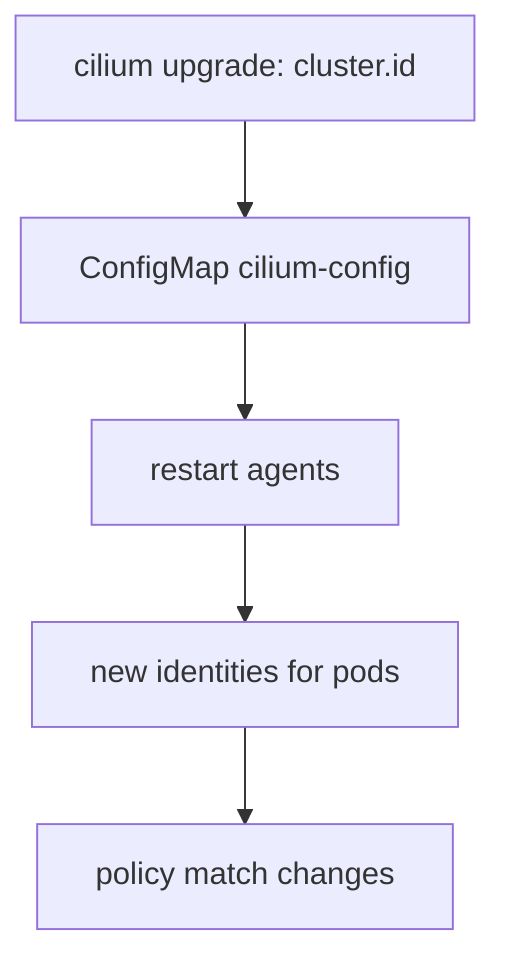

# Cluster ID Limits And Mesh Size

Every cluster of a mesh needs a name and a number, and both have rules. The rules decide how many clusters one mesh can hold and how a change of identity affects a running cluster. Teams that ignore them find out late, because the limits appear when the third or the tenth cluster joins. This part states the rules, explains why the number of clusters costs identity space, and shows how to read the settings.

## Name and ID rules

The cluster name identifies a cluster in labels, in policy and in status output. It has at most 32 characters. It may contain lowercase letters, digits and dashes, and it must start and end with a letter or a digit. The name `default` is not allowed in a mesh, and the name must differ in every cluster.

The cluster ID is a number. Cilium uses it to build identifiers that must stay unique across the mesh. The value 0 means "no ID" and is not valid for a cluster in a mesh. In the default configuration the valid range is 1 to 255, so a mesh can hold at most 255 clusters.

## Why the number of clusters costs identities

Cilium keeps the security identity of a pod and the cluster ID together in one 32-bit value. The bits are shared: the more bits the cluster ID takes, the fewer bits remain for the identities inside each cluster. The Helm value `clustermesh.maxConnectedClusters` selects the split. The default, 255, leaves 16 bits for the identity of the cluster. The value 511 allows more clusters and halves the number of identities for each cluster to about 32,000.

An identity is one set of labels, not one pod, so a cluster rarely runs out of identities. A cluster that creates many unique label sets, for example with a label that holds a pod name or a build number, can still reach the limit sooner.

The setting `maxConnectedClusters` must be the same in every cluster of the mesh. Changing it on a running mesh needs a restart of the Cilium components and disrupts traffic, so choose it before the first cluster joins. Use the default of 255 unless a plan for more than 255 clusters exists.

## Changing the identity of a running cluster

The name and the ID are read when an agent starts. A change in `cilium-config` has no effect until the agents restart. The change also moves the pods of that cluster to new security identities, so policy that names the old cluster name stops matching. For that reason, change the identity before a cluster joins a mesh, not after.



The diagram shows the order of events after an identity change. The restart is needed first, and the new identities follow it.

<!-- astrona:playground:renew -->

## Read the limits in the playground

Open a shell in the playground and save the context names:

```sh
export WEST="$(kubectl config current-context)"
export EAST="$ASTRONA_CLUSTER_EAST_CONTEXT"
```

Read the name, the ID and the maximum number of clusters from each cluster:

```sh
for context in "$WEST" "$EAST"; do
  kubectl --context "$context" -n kube-system get configmap cilium-config -o json | jq -r '.data | {"cluster-name": .["cluster-name"], "cluster-id": .["cluster-id"], "max-connected-clusters": .["max-connected-clusters"]}'
done
```

The names are `west` and `east`, and the IDs are 1 and 2. The value of `max-connected-clusters` must be the same in both clusters. A missing key means that the default applies.

Cilium checks the rules at install time. Run the install command in dry mode against a name that breaks a rule to see the message. The command below uses a name with an uppercase letter:

```sh
cilium upgrade --context "$WEST" --version v1.20.4 --reuse-values --set cluster.name=West --dry-run-helm-values
```

If the command prints values and no error, the check happens when the agent starts and the agent then fails to start. Both outcomes teach the same point: validate a name before you roll it out, and never change it on a cluster that already carries policy.

## What you now know

A cluster name has at most 32 characters of lowercase letters, digits and dashes, and an ID from 1 to 255 by default. The setting `maxConnectedClusters` trades the number of clusters against the number of identities per cluster, and every cluster must use the same value. An identity change needs an agent restart and changes the identities of the pods. What is still open is how the clusters are enabled and connected.

## Common pitfalls

- Reusing a cluster ID after a cluster is rebuilt while the old cluster is still in the mesh.
- Using an uppercase name or a name longer than 32 characters.
- Setting `maxConnectedClusters` in some clusters only.
- Changing the cluster name on a cluster that has policy rules with the old name.

> [!WARNING]
> Do not run the upgrade command above without `--dry-run-helm-values` on a cluster that you want to keep. The name `West` is invalid and the agents may fail to start with it.
