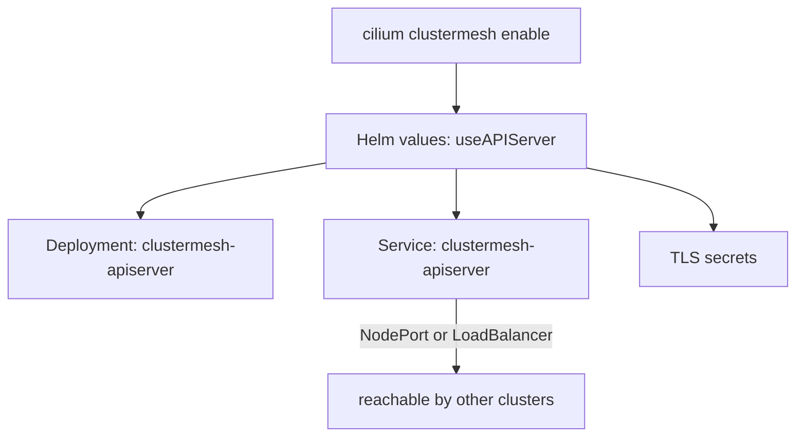

# Enable Cluster Mesh In A Cluster

Cluster Mesh is not on by default. A cluster that runs Cilium has no component that other clusters can talk to, and it has no certificates for that conversation. Enabling Cluster Mesh adds both. This part explains what the enable step creates, how the new component is exposed to other clusters, and how to check that it is healthy before you connect anything.

## What the enable step creates

`cilium clustermesh enable` runs against one cluster. It changes the Helm values of the existing Cilium installation so that `clustermesh.useAPIServer` is true. It then waits for the new objects to appear. The objects are:

- the Deployment `clustermesh-apiserver` in `kube-system`, with one pod that runs the etcd, apiserver and kvstoremesh containers;
- the Service `clustermesh-apiserver`, which exposes the pod to other clusters;
- the TLS secrets for the server and for the clients, signed by the certificate authority of Cilium;
- the ConfigMap that tells the agents which remote clusters to read.

The Helm equivalent is `cilium upgrade --reuse-values --set clustermesh.useAPIServer=true`, with the Service settings added. Both ways produce the same objects.

## How the apiserver is exposed

Other clusters must open a network connection to the `clustermesh-apiserver`. The Service type decides how. The option `--service-type` of the command writes the Helm value `clustermesh.apiserver.service.type`.

- `LoadBalancer` asks the cloud provider for an external address. It is the common choice in a managed cluster.
- `NodePort` opens one port on every node. The other cluster connects to a node IP address and that port. It fits an environment without a load balancer, such as kind, as long as the nodes of the clusters can reach each other.
- `ClusterIP` is only reachable inside the cluster. It is for a mesh that routes the connection by other means.



The diagram shows that one command changes the Helm values, and the objects follow from those values.

The kvstoremesh container is on by default. It keeps a local copy of the data of the remote clusters, so the agents read from the local cache and not from each remote cluster. The option `--enable-kvstoremesh` controls it.

<!-- astrona:playground:renew -->

## Enable Cluster Mesh in both clusters

Open a shell in the playground and save both context names:

```sh
export WEST="$(kubectl config current-context)"
export EAST="$ASTRONA_CLUSTER_EAST_CONTEXT"
```

Enable Cluster Mesh in `west` with a node port, then in `east`:

```sh
cilium clustermesh enable --context "$WEST" --service-type NodePort
cilium clustermesh enable --context "$EAST" --service-type NodePort
```

Each command waits until the new objects exist. Check the Deployment and the Service in `west`:

```sh
kubectl --context "$WEST" -n kube-system get deployment clustermesh-apiserver
kubectl --context "$WEST" -n kube-system get service clustermesh-apiserver
```

The Deployment has one ready replica and the Service has type `NodePort`. Print the node port that the Service uses:

```sh
kubectl --context "$WEST" -n kube-system get service clustermesh-apiserver -o jsonpath='{.spec.ports[0].nodePort}{"\n"}'
```

Another cluster reaches the `clustermesh-apiserver` of `west` at the IP address of a node of `west` on this port.

## Check the control plane

`cilium clustermesh status` reads the state of the control plane in one cluster. With `--wait` it keeps checking until the state is healthy or a time limit ends:

```sh
cilium clustermesh status --context "$WEST" --wait
cilium clustermesh status --context "$EAST" --wait
```

At this point no cluster is connected. The status lists the `clustermesh-apiserver` as ready and shows no connected remote clusters. Use the same command after every change.

## What you now know

Enabling Cluster Mesh deploys the `clustermesh-apiserver`, its certificates and its Service in one cluster. The Service type decides how other clusters reach it, and a node port is the right choice where no load balancer exists. What is still open is how two enabled clusters learn each other's address and credentials.

## Common pitfalls

- Enabling Cluster Mesh in only one cluster and then connecting. Both clusters need a `clustermesh-apiserver`.
- Leaving the Service as `ClusterIP` in an environment where the other cluster must connect from outside.
- Reading a ready Deployment as proof that the mesh works. The control plane is only one half.
- Running `cilium install` again instead of `cilium upgrade`, which resets values that you set earlier.

> [!WARNING]
> A `LoadBalancer` or `NodePort` Service exposes the `clustermesh-apiserver` outside the cluster. Its connections are protected by mutual TLS, so keep the certificate authority private and limit the network path to the clusters in the mesh.
