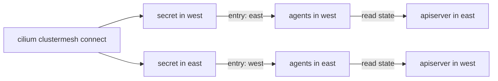

# Connect Clusters And Verify The Data Path

Two clusters that each run a `clustermesh-apiserver` still do not read each other. Each agent needs the address of the remote `clustermesh-apiserver` and a client certificate that the remote side accepts. The connect step provides both. This part explains what the connect step stores, then checks the control plane and the data path, because they can fail independently.

## What connect stores

`cilium clustermesh connect` takes two contexts: the cluster you run it against and the destination. It does five things:

1. It reads the address and port of the `clustermesh-apiserver` of the destination, for example a node IP address and node port.
2. It reads the client certificate and key that the destination issued.
3. It writes the address and the credentials for the destination into the secret `cilium-clustermesh` of the first cluster.
4. It does the same in the other direction.
5. It restarts nothing. The agents watch the secret and open a connection to each remote cluster that it lists.

One run therefore connects both directions. The secret has one key for each remote cluster. In the playground the secret of `west` has a key named `east`, and the secret of `east` has a key named `west`.

The option `--connection-mode` selects `bidirectional` (the default), `unicast` or `mesh`. The option `--allow-mismatching-ca` allows clusters that use different certificate authorities. Use it only when you know why the authorities differ.



The diagram shows that one command fills both secrets, and that each cluster's agents then read the state held by the other cluster.

<!-- astrona:playground:renew -->

## Connect the playground clusters

Open a shell in the playground and save the context names:

```sh
export WEST="$(kubectl config current-context)"
export EAST="$ASTRONA_CLUSTER_EAST_CONTEXT"
```

The playground clusters are not enabled yet. Enable them and wait for the control planes:

```sh
cilium clustermesh enable --context "$WEST" --service-type NodePort
cilium clustermesh enable --context "$EAST" --service-type NodePort
cilium clustermesh status --context "$WEST" --wait
cilium clustermesh status --context "$EAST" --wait
```

Connect the clusters:

```sh
cilium clustermesh connect --context "$WEST" --destination-context "$EAST"
```

Wait for the status of both clusters to become healthy:

```sh
cilium clustermesh status --context "$WEST" --wait
cilium clustermesh status --context "$EAST" --wait
```

Now the status lists the remote cluster as connected.

## Read what the connection stored

List the keys of the secret in each cluster:

```sh
kubectl --context "$WEST" -n kube-system get secret cilium-clustermesh -o json | jq -r '.data | keys[]'
kubectl --context "$EAST" -n kube-system get secret cilium-clustermesh -o json | jq -r '.data | keys[]'
```

The first command lists `east` and the second lists `west`. Each entry names a remote cluster, and its value holds the connection details.

## Prove the data path

A healthy control plane shows that the agents can read the remote state. It does not show that packets cross the network. Prove the data path with a request. Read the IP address of a `probe` pod in `east` and request it from the `shuttle` pod in `west`:

```sh
EAST_PROBE_IP="$(kubectl --context "$EAST" -n starfleet get pod -l app=probe -o jsonpath='{.items[0].status.podIP}')"
kubectl --context "$WEST" -n starfleet exec shuttle -- curl -s --max-time 5 "http://$EAST_PROBE_IP:5678"
```

The reply is `probe from east`. The pod IP address belongs to `east`, so the reply shows that the agents of `west` route the request to a remote pod. Repeat the request in the other direction with a `probe` pod of `west` and the `shuttle` of `east`.

## What you now know

The connect step writes the address and credentials of each cluster into the secret of the other, so one command connects both directions. The status command shows the state of the control plane, and a request to a remote pod IP address shows that the data path works. What is still open is how to control which pods may use that path.

## Common pitfalls

- Running `cilium clustermesh connect` before both clusters finished the enable step.
- Running connect in both directions. One run is enough for the default mode.
- Reading a healthy status as proof of the data path. Always test with a request.
- Using `--allow-mismatching-ca` to hide a certificate authority problem that should be fixed.

> [!WARNING]
> Connecting clusters puts them in one trust domain. After the connection, a pod in one cluster can reach pods in the other unless a network policy denies it.
