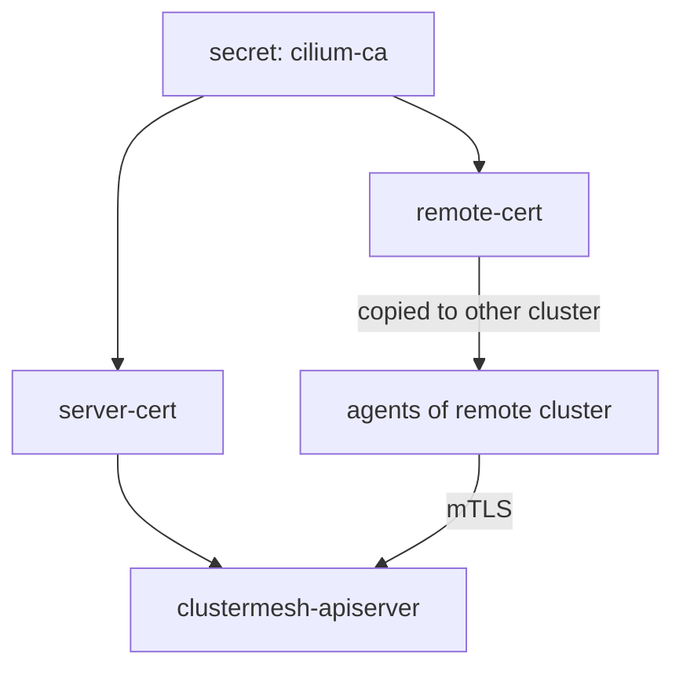

# Helm Values And Certificates Of The Mesh

The command `cilium clustermesh enable` is a shortcut. Underneath, it changes Helm values of the Cilium release and Helm creates the objects. Teams that install Cilium with Helm, Argo CD or Flux set those values in a file instead of running the command. This part names the values, explains which certificates the mesh creates and shows how to find them in a running cluster.

## The values behind the command

Cilium reads the following Helm values for a mesh. The first two are always set:

- `cluster.name` and `cluster.id` give the cluster its identity.
- `clustermesh.useAPIServer` deploys the `clustermesh-apiserver`.
- `clustermesh.apiserver.service.type` chooses `LoadBalancer`, `NodePort` or `ClusterIP` for the Service of the apiserver. The command option `--service-type` writes this value.
- `clustermesh.apiserver.replicas` sets the number of apiserver replicas. More than one replica gives high availability.
- `clustermesh.apiserver.tls.auto.enabled` and `clustermesh.apiserver.tls.auto.method` choose how the certificates of the apiserver are created. The methods are `helm`, `cronJob` and `certmanager`.

With the method `helm`, Helm creates the certificates when it renders the release. They are valid for a fixed time and renew only when you run an upgrade. With `cronJob`, a Kubernetes CronJob creates them on a schedule and renews them before they expire. With `certmanager`, the cert-manager operator issues them from an issuer that you provide.

## The certificates of the mesh

The mesh uses mutual TLS, so each side holds a certificate that the other side trusts. Four secrets in `kube-system` carry them:

- `clustermesh-apiserver-server-cert` is the server certificate of the apiserver.
- `clustermesh-apiserver-admin-cert` is the certificate that the apiserver uses to write its own state.
- `clustermesh-apiserver-remote-cert` is the client certificate that the agents of other clusters use to read the state of this cluster.
- `clustermesh-apiserver-local-cert` is the client certificate that the local agents use to read the local apiserver.

All of them are signed by the certificate authority of the cluster, stored in the secret `cilium-ca`. A remote cluster accepts a client certificate only if the certificate authority that signed it is the one that the remote cluster trusts. That is why the clusters of a mesh share one authority, or why you add the authority of the other cluster on purpose.



The diagram shows that the remote client certificate leaves the cluster during the connect step, and the remote agents present it to the apiserver.

## When certificates expire

A mesh whose certificates expire stops exchanging state. The agents keep the data they already have, but they cannot learn changes. The status of the mesh then shows the remote cluster as not ready, with a certificate error in the logs of the agent. With the `helm` method, run `cilium upgrade` before the expiry. With `cronJob` or `certmanager`, check that the job or the issuer works.

<!-- astrona:playground:renew -->

## Find the secrets in the playground

Open a shell in the playground and save the context names:

```sh
export WEST="$(kubectl config current-context)"
export EAST="$ASTRONA_CLUSTER_EAST_CONTEXT"
```

Enable Cluster Mesh in `west` with a node port, so the secrets exist:

```sh
cilium clustermesh enable --context "$WEST" --service-type NodePort
cilium clustermesh status --context "$WEST" --wait
```

List the secrets of the mesh:

```sh
kubectl --context "$WEST" -n kube-system get secrets -o name | grep -E 'clustermesh|cilium-ca'
```

The list contains the four `clustermesh-apiserver-*-cert` secrets and `cilium-ca`. Read the validity of the server certificate:

```sh
kubectl --context "$WEST" -n kube-system get secret clustermesh-apiserver-server-cert -o jsonpath='{.data.tls\.crt}' | base64 -d | openssl x509 -noout -subject -enddate
```

The output shows the subject and the date on which the certificate expires. Note the date: it is the latest day on which you must renew it.

## What you now know

The command `cilium clustermesh enable` sets Helm values: `clustermesh.useAPIServer`, the service type and the certificate method. The mesh uses four certificate secrets signed by the authority in `cilium-ca`. Certificates expire, and the method decides who renews them. What is still open is how the connect step passes the certificates and addresses to the other cluster, and which modes it supports.

## Common pitfalls

- Using `ClusterIP` for the apiserver Service and expecting another cluster to reach it.
- Letting `helm`-method certificates expire because no upgrade ran.
- Reading `cilium-ca` as a secret of the mesh only: it signs other Cilium certificates too.
- Running `cilium clustermesh enable` on a release that you manage with Helm values in Git, so the next sync removes the change.

> [!WARNING]
> The secrets above hold private keys. Print the certificate only, as shown, and never paste the `tls.key` field into a ticket or a chat.
