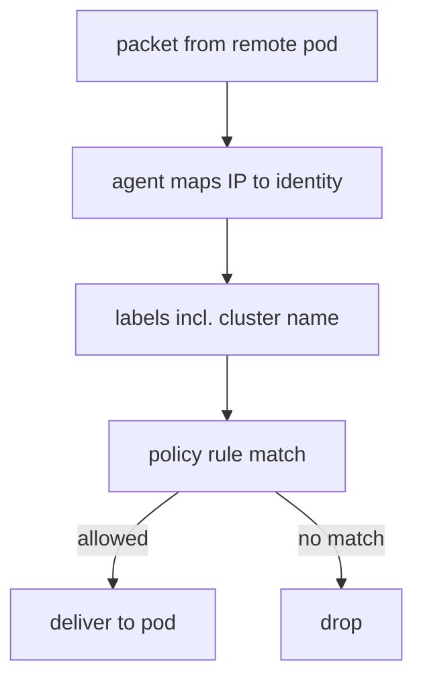

# Identity And The Cluster Label

A network policy has to decide whether a packet from a pod may reach another pod. Inside one cluster, Cilium makes that decision from the labels of the source. In a mesh the source can be a pod of another cluster, and the destination agent has never seen that pod in its own Kubernetes API. This part explains how the mesh gives the destination agent the data it needs, and which label separates two pods that look the same.

## How a remote pod is identified

Cilium represents each group of pods that have the same set of labels as one security identity, a number. The agent on each node keeps a table that maps pod IP addresses to identities. A policy rule is compiled to a list of identities that may reach a protected pod.

When Cluster Mesh is connected, the agents of each cluster also load the endpoints of the remote clusters from the `clustermesh-apiserver` of those clusters. The remote endpoints enter the same table with the same identity numbers. A packet from a remote pod therefore arrives with an IP address that the destination agent can map to an identity, and the policy check works the same way as for a local pod.

Cilium adds labels that Kubernetes does not have. One of them is `io.cilium.k8s.policy.cluster`, whose value is the name of the cluster of the pod. Another is `io.kubernetes.pod.namespace`. Because the cluster label is part of the identity, a pod `shuttle` in `west` and a pod `shuttle` in `east` have different identities, even when all their other labels are equal.



The diagram shows that the cluster name is one of the labels in the match, so a rule can allow one cluster and refuse another.

## Where a policy is enforced

A policy is enforced by the agent on the node of the protected pod. Cilium does not copy a `CiliumNetworkPolicy` from one cluster to another, because each cluster has its own Kubernetes API. The consequence is practical:

- An ingress rule protects the destination, so it is applied in the destination cluster.
- An egress rule protects the source, so it is applied in the source cluster.
- To block traffic in both directions, apply policy in both clusters.

Before Cilium 1.19, a selector with no cluster label matched endpoints of every cluster. From 1.19 a selector matches the local cluster only, unless it names another cluster. Always name the cluster when a rule must apply to a remote workload.

<!-- astrona:playground:renew -->

## Look at the labels

Open a shell in the playground and save the context names:

```sh
export WEST="$(kubectl config current-context)"
export EAST="$ASTRONA_CLUSTER_EAST_CONTEXT"
```

Cilium represents each pod as an endpoint. List the endpoints in `west` with their labels:

```sh
kubectl --context "$WEST" -n starfleet get ciliumendpoints.cilium.io
```

Cilium shows the endpoints that belong to `starfleet`, including the `shuttle`. The same listing in `east` shows its own `shuttle`. The labels of the `shuttle` are identical in the two clusters, and the identity is not, because of the cluster label.

## Test the default

No policy exists, so every pod can reach every pod. Read the pod IP address of a `probe` pod in `east` and request it from the `shuttle` of `west` and from the `drifter` of `west`:

```sh
EAST_PROBE_IP="$(kubectl --context "$EAST" -n starfleet get pod -l app=probe -o jsonpath='{.items[0].status.podIP}')"
kubectl --context "$WEST" -n starfleet exec shuttle -- curl -s --max-time 5 "http://$EAST_PROBE_IP:5678"
kubectl --context "$WEST" -n outpost exec drifter -- curl -s --max-time 5 "http://$EAST_PROBE_IP:5678"
```

Both replies are `probe from east`. Nothing limits the traffic that crosses the mesh, and the `drifter` of another namespace reaches the `probe` pods too.

## Read the identity of a pod

The agent can show the identity numbers that it knows. Ask the agent of `west` for its identity list:

```sh
kubectl --context "$WEST" -n kube-system exec ds/cilium -- cilium-dbg identity list
```

Each line has a number and the label set of the identity. Find the lines with `app=shuttle` and the namespace `starfleet`. The label set of each includes `k8s:io.cilium.k8s.policy.cluster=west` or `k8s:io.cilium.k8s.policy.cluster=east`, so the two `shuttle` pods have different identities. The agent holds the identity of the `shuttle` of `east` because Cluster Mesh loaded it from the remote cluster.

The number of an identity can differ from run to run, so a policy never uses the number. A policy uses labels, and the agent translates the labels to numbers.

## What you now know

A remote pod enters the table of the destination agent with an identity, and that identity includes the cluster label. A policy is enforced in the cluster of the protected pod, and Cilium does not copy it to other clusters. What is still open is how to write a rule that uses the cluster label.

## Common pitfalls

- Applying an ingress policy in the source cluster and expecting it to protect the destination.
- Assuming that a policy created in one cluster appears in the other.
- Relying on a selector that has no cluster label for remote workloads. In Cilium 1.19 and later it selects local endpoints only.
- Treating two pods with equal labels as the same identity. They differ when they run in different clusters.

> [!WARNING]
> After a connection, a pod in one cluster can reach any pod of the other cluster that no policy protects. Check which workloads have no policy before you connect production clusters.
