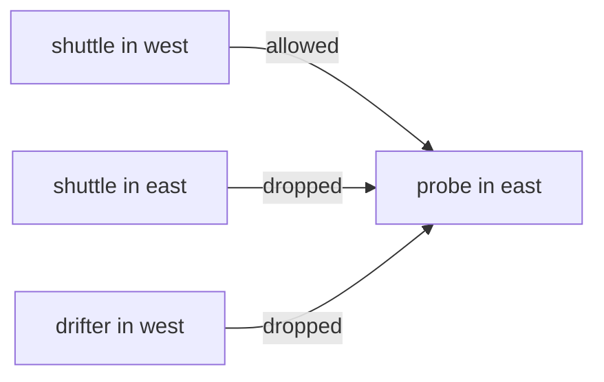

# Writing Cluster-Aware Policies

An open mesh is rarely what a team wants. The usual requirement is narrower: one workload of one named cluster may call a service, and nothing else may. A `CiliumNetworkPolicy` can state that requirement, because its selectors can match the cluster label. This part writes that policy, shows two selector forms, and tests the cases that a careless policy gets wrong.

## The shape of the policy

A `CiliumNetworkPolicy` has an `endpointSelector` that chooses the protected pods. Each rule under `ingress` lists sources in `fromEndpoints`. Each entry in `fromEndpoints` is a label selector. A pod matches when it has all the labels in `matchLabels`.

Once any ingress rule selects a pod, that pod accepts only the traffic that a rule allows. Traffic that no rule allows is dropped. A rule for one source therefore also denies all other sources for the selected pods.

To allow the `shuttle` of the cluster `west` only, the selector needs the workload label and the cluster label:

- `app: shuttle` matches the workload.
- `io.cilium.k8s.policy.cluster: west` matches the cluster.

Without the cluster label, in Cilium 1.19 and later, the selector matches the local cluster only. In earlier versions it matched every cluster. Name the cluster in either case, so the policy means the same on every version.

## Two selector forms

`matchLabels` fits an exact value. For a set of clusters or for any cluster, use `matchExpressions`. The operator `Exists` matches a pod that has the key, with any value:

```yaml
fromEndpoints:
- matchLabels:
    app: shuttle
  matchExpressions:
  - key: io.cilium.k8s.policy.cluster
    operator: Exists
```

That selector allows the `shuttle` of every cluster, local or remote. The operator `In` with a list of values allows a chosen set of clusters.



The diagram shows the result of the policy that you write below: only the `shuttle` of `west` reaches the `probe` pods of `east`.

<!-- astrona:playground:renew -->

## Write and apply the policy

Open a shell in the playground and save the context names:

```sh
export WEST="$(kubectl config current-context)"
export EAST="$ASTRONA_CLUSTER_EAST_CONTEXT"
```

The `probe` pods run in `east`, so the ingress rule goes to `east`. Save this as `cnp-probe-from-west-shuttle.yaml`:

```yaml
apiVersion: cilium.io/v2
kind: CiliumNetworkPolicy
metadata:
  name: probe-from-west-shuttle
  namespace: starfleet
spec:
  endpointSelector:
    matchLabels:
      app: probe
  ingress:
  - fromEndpoints:
    - matchLabels:
        app: shuttle
        io.cilium.k8s.policy.cluster: west
```

Apply it in `east`:

```sh
kubectl --context "$EAST" apply -f cnp-probe-from-west-shuttle.yaml
```

Then check the result. Read the IP address of a `probe` pod and send three requests from the three clients:

```sh
EAST_PROBE_IP="$(kubectl --context "$EAST" -n starfleet get pod -l app=probe -o jsonpath='{.items[0].status.podIP}')"
kubectl --context "$WEST" -n starfleet exec shuttle -- curl -s --max-time 5 "http://$EAST_PROBE_IP:5678"
kubectl --context "$WEST" -n outpost exec drifter -- curl -s --max-time 5 "http://$EAST_PROBE_IP:5678"
kubectl --context "$EAST" -n starfleet exec shuttle -- curl -s --max-time 5 "http://$EAST_PROBE_IP:5678"
```

The first request returns `probe from east`. The other two wait five seconds and end with no reply, because the policy drops them. The second is dropped because its labels do not match. The third has the right workload label but the wrong cluster label, so it is dropped as well.

## Where the policy does not apply

The policy exists only in `east`. Apply the same kind of rule in `west` to see that it does not change the traffic to `east`: an ingress rule in `west` protects the pods of `west`, not the pods of `east`. A policy for traffic that leaves `west` is an egress rule, and it also has to be applied in `west`.

## What you now know

A cluster-aware policy lists workload labels and the cluster label in the same selector. The policy is applied in the cluster of the protected pod, and Cilium drops everything that no rule allows. A pod with the same workload labels in the wrong cluster does not match. What is still open is how Services use several clusters, which is a question of discovery and not of policy.

## Common pitfalls

- Writing the selector with the workload label only. It then allows pods of the local cluster that have the label, and it does not describe the remote cluster.
- Applying the policy in `west` for traffic that enters `east`.
- Testing only the allowed case. Always test a pod that must be denied, and one that has the same labels in the wrong cluster.
- Forgetting that a rule for one source denies every other source for the selected pods.

> [!WARNING]
> A new ingress policy drops traffic from every source that it does not list, including clients that worked a minute before. List every client that must keep working before you apply it.
