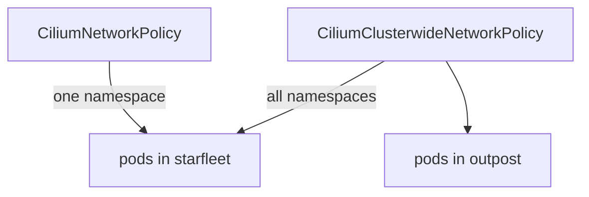

# Deny Rules, Egress Rules And Clusterwide Policy

An allow rule limits traffic by exclusion: once a rule selects a pod, everything not listed is dropped. Some requirements are the reverse. A team may want to keep the default behaviour and block one cluster, or protect every namespace at once. Cilium has three tools for this: deny rules, egress rules and clusterwide policies. This part explains each one and shows how the cluster label works in all of them.

## Deny rules

A `CiliumNetworkPolicy` can hold `ingressDeny` and `egressDeny` rules. A deny rule drops matching traffic, and it always wins over an allow rule. When a pod has no allow rules at all, a deny rule blocks only the traffic it names and leaves the rest open. That makes deny rules a good fit for "block this cluster" requirements.

A deny rule names its sources with the same selectors as an allow rule. To block every pod of the cluster `east` from reaching the `probe` pods, select them by the cluster label:

```yaml
ingressDeny:
- fromEndpoints:
  - matchLabels:
      io.cilium.k8s.policy.cluster: east
```

Because deny wins, adding an allow rule for a `shuttle` of `east` later does not reopen the path. Remove the deny rule to reopen it.

## Egress rules

An egress rule restricts what a pod may send. The agent of the source pod enforces it, so the rule belongs in the source cluster. The destination is chosen with `toEndpoints`, which uses the same labels, including the cluster label. An egress rule that allows `app: probe` with `io.cilium.k8s.policy.cluster: east` lets the selected pods call the `probe` pods of `east` and blocks other destinations, such as the pods of the local cluster.

When a rule restricts egress for a pod, the pod also needs an egress rule for DNS if it resolves names. Without it, name lookups fail, and the failure looks like a network problem.

## Clusterwide policy

A `CiliumNetworkPolicy` lives in one namespace and selects pods of that namespace. A `CiliumClusterwideNetworkPolicy` has no namespace. It selects pods in every namespace of the cluster, and its rules can name sources in every namespace. Use it for a rule that applies to the whole cluster, for example "no pod accepts traffic from the cluster `east` unless a policy allows it". Like other policy, it applies in the cluster where you create it and does not travel to other clusters.



The diagram shows that a clusterwide policy reaches pods in namespaces that a namespaced policy does not.

<!-- astrona:playground:renew -->

## Block one cluster with a deny rule

Open a shell in the playground and save the context names:

```sh
export WEST="$(kubectl config current-context)"
export EAST="$ASTRONA_CLUSTER_EAST_CONTEXT"
```

Enable and connect the clusters so that pods can reach each other:

```sh
cilium clustermesh enable --context "$WEST" --service-type NodePort
cilium clustermesh enable --context "$EAST" --service-type NodePort
cilium clustermesh status --context "$WEST" --wait
cilium clustermesh status --context "$EAST" --wait
cilium clustermesh connect --context "$WEST" --destination-context "$EAST"
cilium clustermesh status --context "$WEST" --wait
```

Read the IP address of a `probe` pod in `west` and request it from the `shuttle` of `east`. The request works, because no policy exists:

```sh
WEST_PROBE_IP="$(kubectl --context "$WEST" -n starfleet get pod -l app=probe -o jsonpath='{.items[0].status.podIP}')"
kubectl --context "$EAST" -n starfleet exec shuttle -- curl -s --max-time 5 "http://$WEST_PROBE_IP:5678"
```

Save this as `cnp-probe-deny-east.yaml`:

```yaml
apiVersion: cilium.io/v2
kind: CiliumNetworkPolicy
metadata:
  name: probe-deny-east
  namespace: starfleet
spec:
  endpointSelector:
    matchLabels:
      app: probe
  ingressDeny:
  - fromEndpoints:
    - matchLabels:
        io.cilium.k8s.policy.cluster: east
```

The `probe` pods run in `west`, so apply the policy in `west`:

```sh
kubectl --context "$WEST" apply -f cnp-probe-deny-east.yaml
```

Then check the result. Repeat the request from `east`, and request the same pod from the `shuttle` of `west`:

```sh
kubectl --context "$EAST" -n starfleet exec shuttle -- curl -s --max-time 5 "http://$WEST_PROBE_IP:5678"
kubectl --context "$WEST" -n starfleet exec shuttle -- curl -s --max-time 5 "http://$WEST_PROBE_IP:5678"
```

The first request prints nothing and ends after five seconds, because the agent in `west` drops the packet. The second request still works. The deny rule names the cluster `east` only, so local pods keep their access, and the rest of the traffic stays open because no allow rule selects the pods.

## What you now know

Deny rules block named traffic and always win over allow rules. Egress rules protect the source and belong in the source cluster, and a pod with an egress rule needs a DNS rule too. A clusterwide policy applies to every namespace of one cluster. What is still open is how to see why a packet was dropped.

## Common pitfalls

- Expecting a deny rule in `west` to stop traffic that leaves `west`. Ingress rules apply at the destination.
- Writing an egress rule and forgetting the DNS rule.
- Applying a clusterwide policy in one cluster and expecting the other cluster to follow.
- Adding an allow rule to undo a deny rule. The deny rule still wins.

> [!WARNING]
> A clusterwide deny rule affects every namespace, including `kube-system`. Test it in a playground first and name namespaces in the selector.
