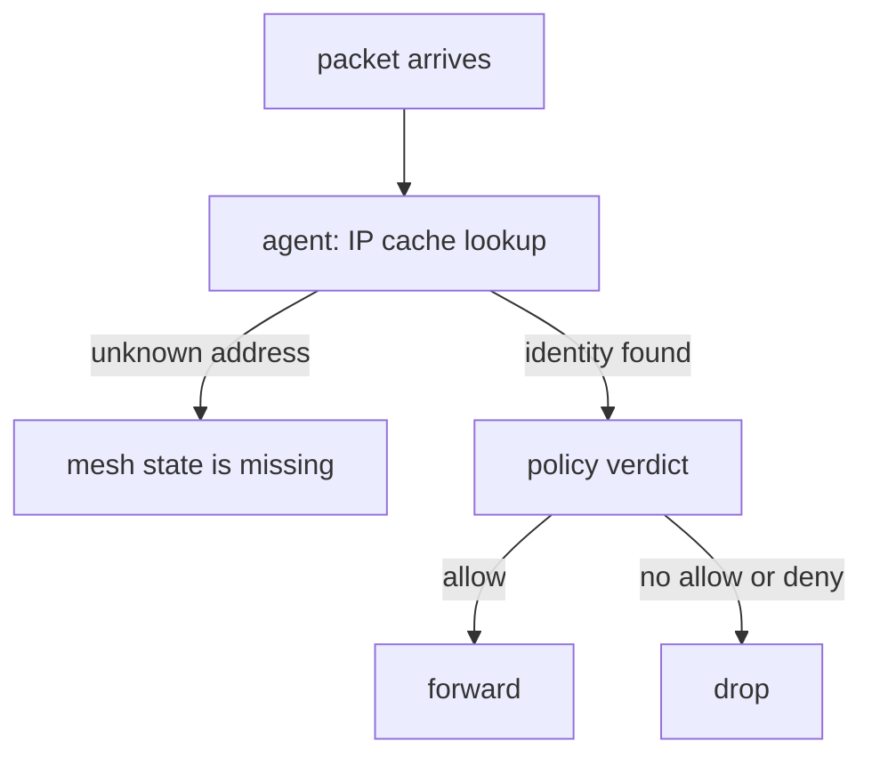

# See Why A Packet Is Dropped

A policy that blocks the wrong traffic is hard to debug from the client, because the client only sees a timeout. The decision happens on the node of the destination pod, inside the Cilium agent and its eBPF programs. To find the cause, you must look at what the agent knows: the identity of the source, the labels behind it and the verdict of the policy. This part shows three views and a method for using them in a mesh.

## What the agent knows about a remote pod

The agent keeps a table that maps IP addresses to security identities. This table is the IP cache. With Cluster Mesh, the agent adds the pod IP addresses of the remote clusters to the same table, with the identity of each pod. When a packet arrives, the agent looks up the source address. If the address is not in the table, the agent cannot tell what the source is, and the policy treats it as an unknown source.

A remote pod that is missing from the IP cache has a clear meaning. The mesh did not deliver that endpoint to this agent, so the cause is in the connection, not in the policy. A remote pod that is in the table with an unexpected identity points to the policy, because the identity decides which rules match.

## The policy verdict

For each packet, the agent compares the source identity with the rules of the destination endpoint and returns a verdict: forwarded, dropped by a missing allow rule, or denied by a deny rule. The monitor of the agent prints these events live. A drop line contains the reason, the source and destination identity numbers and the addresses. Two reasons matter most: "Policy denied" for a missing allow rule and "Policy denied by denylist" for a deny rule.



The diagram shows the order of the checks. A lookup failure and a policy drop are different problems with different fixes.

<!-- astrona:playground:renew -->

## Look at the agent state

Open a shell in the playground and save the context names:

```sh
export WEST="$(kubectl config current-context)"
export EAST="$ASTRONA_CLUSTER_EAST_CONTEXT"
```

Enable and connect the clusters:

```sh
cilium clustermesh enable --context "$WEST" --service-type NodePort
cilium clustermesh enable --context "$EAST" --service-type NodePort
cilium clustermesh status --context "$WEST" --wait
cilium clustermesh status --context "$EAST" --wait
cilium clustermesh connect --context "$WEST" --destination-context "$EAST"
cilium clustermesh status --context "$WEST" --wait
```

List the addresses that the agent of `west` knows, with their identities. The listing includes the pods of `east`:

```sh
kubectl --context "$WEST" -n kube-system exec ds/cilium -c cilium-agent -- cilium-dbg bpf ipcache list
```

Find a pod address of `east` in the list. It has an identity number, and the list marks its type. If the address of an `east` pod is missing, check `cilium clustermesh status` first.

Look at the labels behind an identity. The command below prints the identities that the agent knows, with their labels:

```sh
kubectl --context "$WEST" -n kube-system exec ds/cilium -c cilium-agent -- cilium-dbg identity list
```

The labels of a remote pod include `k8s:io.cilium.k8s.policy.cluster=east`. That label is the one that cluster-aware policy matches.

## Watch drops live

Start the monitor in the agent of `west`. It prints only drop events while it runs. Keep it open in this terminal:

```sh
kubectl --context "$WEST" -n kube-system exec ds/cilium -c cilium-agent -- cilium-dbg monitor --type drop
```

Open a second terminal with `astrona shell`, set the two variables again, and apply an ingress deny rule in `west` that names the cluster `east` for the `probe` pods, then request a `probe` pod of `west` from the `shuttle` of `east`. The monitor prints a drop line for the request. Press Ctrl+C to stop the monitor. If no line appears, the packet did not reach the agent of `west`, so look at the data path, not at the policy.

## What you now know

The IP cache shows whether the agent knows a remote pod, and the identity list shows the labels behind an identity. The monitor shows each drop with its reason. Together they separate a mesh problem from a policy problem. What is still open is how a whole mesh is kept healthy, which needs a view of the control plane.

## Common pitfalls

- Debugging policy when the remote pod is missing from the IP cache.
- Leaving `cilium-dbg monitor` running on a busy node and reading its output without a type filter.
- Comparing identity numbers between clusters by eye instead of reading their labels.
- Looking for the drop in the source cluster when an ingress rule at the destination caused it.

> [!WARNING]
> The `cilium-dbg` commands read the state of one agent on one node. In a cluster with several nodes, run them on the node that runs the destination pod.
