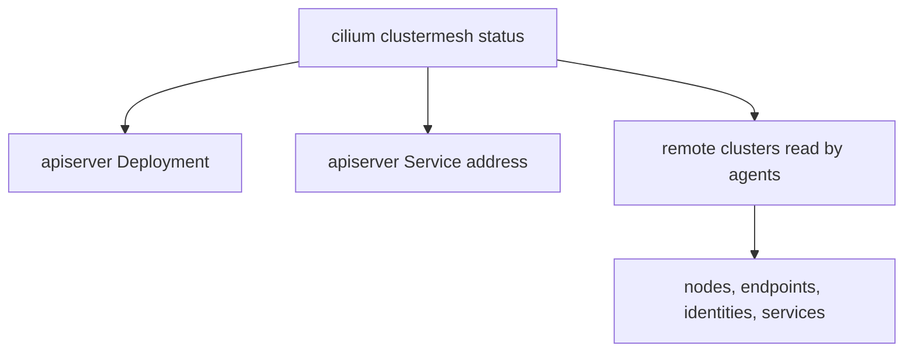

# Read The Status Of A Mesh

A mesh that was healthy yesterday can be broken today. A certificate expired, a node port changed or a cluster was rebuilt. The first task of an operator is to read the status and understand each line of it. This part names the places where Cilium reports the state of a mesh and says what each report proves and what it does not prove.

## Three levels of status

The state of a mesh is visible at three levels:

- The Kubernetes level shows whether the Pods and Services exist. The `clustermesh-apiserver` Deployment and its Service belong here.
- The Cilium command-line tool level shows the result that the tool reads from the cluster. The command `cilium clustermesh status` belongs here.
- The agent level shows what one agent on one node knows. The command `cilium-dbg status --verbose` run inside an agent Pod belongs here.

A fault shows at a different level depending on its cause. A missing Deployment is a Kubernetes fault. A refused connection to the remote apiserver appears in the tool and in the agent. An agent that learned nothing from a connected cluster appears only at the agent level.

## What `cilium clustermesh status` reports

The command checks the local `clustermesh-apiserver` and every remote cluster that the local cluster is configured to read. It reports the following:

- Whether the Service of the apiserver has an address that other clusters can reach, and which address and port that is.
- Whether the Deployment of the apiserver is ready.
- For each remote cluster, the number of agents that are connected and the number of clusters the agents expect, and the number of nodes, endpoints, identities and services that were read from it.

A remote cluster that the agents read but cannot connect to is listed with fewer connected agents than expected. The option `--wait` makes the command wait until the status is healthy or a timeout ends.



The diagram shows what the command checks. The counts at the bottom show whether the state of the remote cluster arrived.

## What the counts prove

A remote cluster with zero endpoints while it runs pods is a sign that the connection works but the state did not arrive. The cause is often a cluster that was connected before its workloads started and has not synchronized, or an apiserver that cannot write its state. A status that shows connected agents and non-zero counts proves the control path. It does not prove the data path. Only a request between pods proves that.

<!-- astrona:playground:renew -->

## Read the status in the playground

Open a shell in the playground and save the context names:

```sh
export WEST="$(kubectl config current-context)"
export EAST="$ASTRONA_CLUSTER_EAST_CONTEXT"
```

The clusters are connected already. Read the status of `west`:

```sh
cilium clustermesh status --context "$WEST"
```

The output lists the address of the apiserver Service and the remote cluster `east` with its counts. Read the same status from the side of `east`:

```sh
cilium clustermesh status --context "$EAST"
```

The output lists `west` as the remote cluster. Now read the view of a single agent, which includes the line for the mesh:

```sh
kubectl --context "$WEST" -n kube-system exec ds/cilium -c cilium-agent -- cilium-dbg status --verbose
```

Find the section about ClusterMesh. It lists the remote cluster, whether the connection is ready and the counts of what the agent read. The numbers should match the ones in the first command.

Finally, read the Kubernetes level:

```sh
kubectl --context "$WEST" -n kube-system get deployment,service clustermesh-apiserver
```

## What you now know

The state of a mesh is visible at the Kubernetes level, the tool level and the agent level. The command `cilium clustermesh status` reports the apiserver and the counts read from each remote cluster, and `cilium-dbg status --verbose` shows the view of one agent. A healthy status proves the control path only. What is still open is what the pieces inside the apiserver do, which affects how you read its logs.

## Common pitfalls

- Reading only the status of one cluster. A mesh has two sides, and each side can fail separately.
- Treating zero endpoints as a failure of the mesh when the remote cluster runs no pods.
- Using one agent's view to judge all nodes.
- Taking a healthy status as proof that pods reach each other.

> [!WARNING]
> The option `--wait` can end with a timeout and an error that hides the real cause. Read the status without `--wait` as well, to see which line is not healthy.
