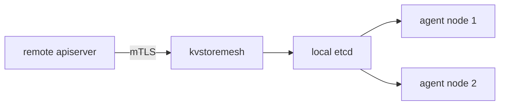

# The clustermesh-apiserver And KVStoreMesh

When a status line fails, the next question is which component to inspect. The `clustermesh-apiserver` Pod holds several containers, and each one has a different job and its own logs. Knowing the jobs tells you where to look and also shows how a mesh scales. This part explains the containers, the role of KVStoreMesh and the reason why agents do not talk to every remote cluster directly.

## The containers of the Pod

The Pod `clustermesh-apiserver` runs these main containers:

- `apiserver` watches the Kubernetes API of the local cluster for endpoints, identities, nodes and Services, and writes them into the local etcd.
- `etcd` is a key-value database that stores that state. Remote clusters read it.
- `kvstoremesh` connects to the `clustermesh-apiserver` of each remote cluster, reads the state and writes a copy into the local etcd.

The names can differ slightly between versions, so list them with `kubectl get pod -o jsonpath` before you ask for logs.

## What KVStoreMesh changes

Without KVStoreMesh, every agent in a cluster connects to the apiserver of every remote cluster. In a mesh of ten clusters with fifty nodes each, that means five hundred connections arrive at each remote apiserver. With KVStoreMesh, only the `kvstoremesh` container connects to the remote apiserver. The agents read the copy from the local etcd instead.

This design has two effects. The load on the remote apiservers depends on the number of clusters, not on the number of nodes. And an agent can restart and read the data from the local copy even when the remote cluster is unreachable, so a short outage of a remote cluster does not delay a local agent.



The diagram shows that the agents read from the local database, and only one component connects to the remote cluster.

The Helm value `clustermesh.apiserver.kvstoremesh.enabled` turns KVStoreMesh on or off. It is on by default in current releases. When it is on, the agents are configured to read from the local etcd, and the connect step stores the remote address for `kvstoremesh`.

## Where to look for which fault

A fault in the local data, such as a missing endpoint of a local pod in other clusters, points to the `apiserver` container. A fault in the copy of a remote cluster points to `kvstoremesh`. A fault of the database itself points to `etcd`. The remote apiserver is not part of the local Pod, so to inspect it, use the context of the remote cluster.

<!-- astrona:playground:renew -->

## Inspect the Pod in the playground

Open a shell in the playground and save the context names:

```sh
export WEST="$(kubectl config current-context)"
export EAST="$ASTRONA_CLUSTER_EAST_CONTEXT"
```

List the containers of the apiserver Pod in `west`:

```sh
kubectl --context "$WEST" -n kube-system get pod -l k8s-app=clustermesh-apiserver -o jsonpath='{range .items[0].spec.containers[*]}{.name}{"\n"}{end}'
```

The list contains `apiserver`, `etcd` and, when KVStoreMesh is on, `kvstoremesh`. Read the last lines of the `kvstoremesh` log:

```sh
kubectl --context "$WEST" -n kube-system logs deployment/clustermesh-apiserver -c kvstoremesh --tail=20
```

The log shows messages about the connection to the remote cluster `east`. A healthy mesh shows that the connection is established. An error line with a certificate or a connection refused message points to the fault. Read the log of the `apiserver` container the same way:

```sh
kubectl --context "$WEST" -n kube-system logs deployment/clustermesh-apiserver -c apiserver --tail=20
```

Check the Helm setting that controls KVStoreMesh by reading the ConfigMap key that the agents use:

```sh
kubectl --context "$WEST" -n kube-system get configmap cilium-config -o json | jq -r '.data | to_entries[] | select(.key | test("clustermesh|kvstoremesh")) | "\(.key)=\(.value)"'
```

The lines show the settings that the agent reads for the mesh. If a key is missing, the default applies.

## What you now know

The apiserver Pod writes the local state into a local etcd, and KVStoreMesh copies the state of each remote cluster into it. Agents read from the local copy, so the number of connections to a remote cluster depends on the number of clusters. Each container has its own log. What is still open is a method to find the cause of a broken connection.

## Common pitfalls

- Asking for logs without naming the container, which fails or shows only the default container.
- Looking for remote faults in the local `apiserver` container.
- Expecting a remote outage to remove the local copy at once. The copy remains until the next sync.
- Disabling KVStoreMesh in a large mesh and overloading the remote apiservers.

> [!WARNING]
> The label selector `k8s-app=clustermesh-apiserver` may differ in your release. If the command returns nothing, list the Pods of `kube-system` and use the labels you find there.
