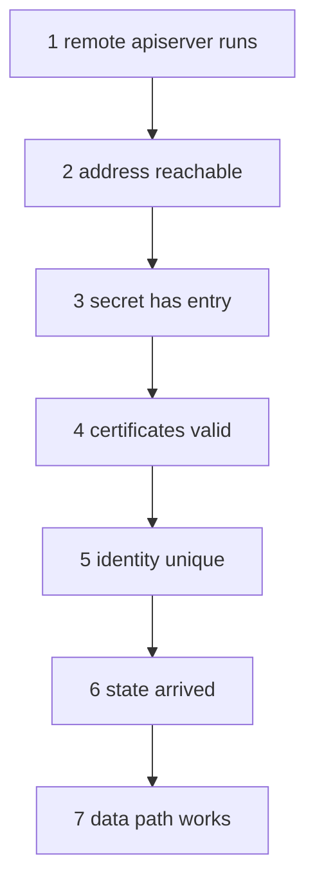

# Troubleshoot A Broken Connection

A broken mesh gives few clear errors. Pods stop reaching each other, or a global service loses its remote backends, and the status shows a remote cluster that is not ready. A fixed order of checks finds the cause faster than guessing, because each check removes one layer of the system. This part gives the order, the command for each check and the fault that each check points to.

## The order of checks

Work from the outside in. Each step assumes the previous one passed.

1. The apiserver of the remote cluster runs. Check the Deployment and its Pods in the remote cluster.
2. The Service of the remote apiserver has an address, and the nodes of the local cluster can reach it. Check the node port or the load balancer address, and the firewall between the clusters.
3. The local cluster holds the connection details. Check the keys of the secret `cilium-clustermesh`.
4. The certificates are valid and trusted. Check the expiry and the certificate authority, and read the log for TLS errors.
5. The cluster identities do not collide. Check names, IDs and pod ranges.
6. The state arrived. Read the counts in `cilium clustermesh status`.
7. The data path works. Test with a request between pods, and check the tunnel port.



The diagram shows the order of the checks. Stop at the first step that fails and fix it before you go on.

## What the agent can tell you

Since Cilium 1.15 the agent has a built-in checker. The command `cilium-dbg troubleshoot clustermesh` runs inside an agent Pod. It reads the connection details of every configured remote cluster, tries to resolve each endpoint, opens a connection with the client certificate and tries to read from the remote etcd. It prints the result of each step and the point where it failed. With a cluster name as argument it checks only that cluster.

The checker answers steps 2 to 4 in one run. Its output tells whether the failure is a name that does not resolve, a connection that is refused or times out, a certificate that is rejected, or a permission error.

## Reading the log of the agent

The agent logs each attempt to connect to a remote cluster with the cluster name in a field. Lines with `clustermesh` and an error text give the cause: `x509: certificate signed by unknown authority` points to a different authority, `connection refused` to a closed port and `i/o timeout` to a firewall or a wrong address. Use `grep` on the name of the remote cluster to cut the noise.

<!-- astrona:playground:renew -->

## Break and fix the connection

Open a shell in the playground and save the context names:

```sh
export WEST="$(kubectl config current-context)"
export EAST="$ASTRONA_CLUSTER_EAST_CONTEXT"
```

The clusters are connected. Run the checker in an agent Pod of `west`:

```sh
kubectl --context "$WEST" -n kube-system exec ds/cilium -c cilium-agent -- cilium-dbg troubleshoot clustermesh
```

Each step is reported for the cluster `east`. Now break the connection: stop the apiserver of `east`.

```sh
kubectl --context "$EAST" -n kube-system scale deployment clustermesh-apiserver --replicas=0
```

Wait about thirty seconds. Then run the checker and the status again:

```sh
kubectl --context "$WEST" -n kube-system exec ds/cilium -c cilium-agent -- cilium-dbg troubleshoot clustermesh
cilium clustermesh status --context "$WEST"
```

The checker reports the step at which it fails, a refused connection or a timeout, and the status shows fewer connected agents for `east`. Search the log of an agent for the cause:

```sh
kubectl --context "$WEST" -n kube-system logs ds/cilium -c cilium-agent --tail=200 | grep -i clustermesh | grep -i east | tail -5
```

Restore the apiserver and wait for the status to become healthy again:

```sh
kubectl --context "$EAST" -n kube-system scale deployment clustermesh-apiserver --replicas=1
cilium clustermesh status --context "$WEST" --wait
```

The status is healthy once the agents reconnect. The pods never stopped reaching each other during the outage, because existing endpoints stay in the tables of the agents.

## What you now know

Troubleshooting a mesh follows seven checks from the remote apiserver to the data path. The command `cilium-dbg troubleshoot clustermesh` covers address, certificate and connection in one run, and the agent log names the cause. A short outage of a remote apiserver does not remove known endpoints. What is still open is how to remove a connection on purpose.

## Common pitfalls

- Starting with the certificates before the apiserver is confirmed to run.
- Reading only the local side. The cause is often in the remote cluster.
- Restarting agents to fix a connection. This hides the cause and interrupts traffic.
- Testing with a service name when the pod-to-pod path is the thing that is broken.

> [!WARNING]
> Scaling the apiserver to zero stops state updates for every other cluster. Do it only in a playground.
