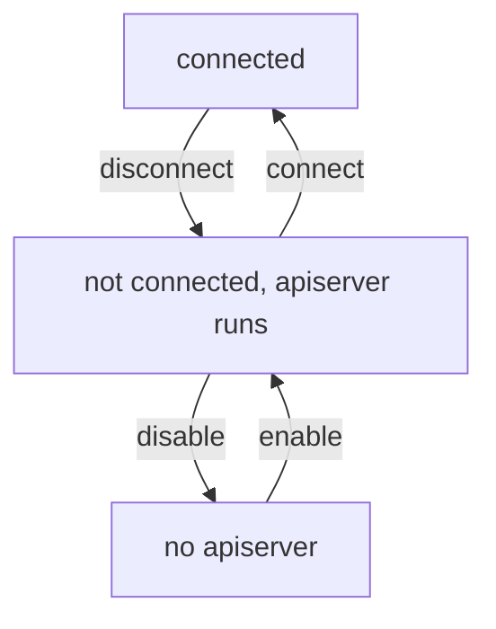

# Disconnect And Disable A Mesh

Clusters leave a mesh for many reasons. A team retires a cluster, an environment moves to another network, or a mesh was only a test. Leaving is not the same as breaking the connection, and a clean exit needs two different commands. This part explains what each command removes, what it leaves behind and what the pods of each cluster experience.

## Disconnect

The command `cilium clustermesh disconnect` removes the connection between two clusters. It takes the local context and the destination context, like the connect command. It removes the entry of the destination from the secret `cilium-clustermesh` of the local cluster, and the entry of the local cluster from the secret of the destination. The agents notice the change in the secret and close the connections.

After this, the agents of each cluster remove the endpoints, nodes, identities and Service backends that they had read from the other cluster. A global service loses the remote backends. A policy rule that names the other cluster no longer matches any pod. A pod of one cluster cannot reach a pod of the other by its pod IP address, because the route and the tunnel information for the remote nodes are gone.

The `clustermesh-apiserver` keeps running in both clusters. The certificates stay. A later `cilium clustermesh connect` restores the connection without a new enable step.

## Disable

The command `cilium clustermesh disable` removes the mesh support from one cluster. It sets the Helm value `clustermesh.useAPIServer` to false, which removes the `clustermesh-apiserver` Deployment and its Service. Run it only after all connections to and from that cluster are removed. A cluster that still has remote clusters in its secret and a disabled apiserver leaves the other clusters with a connection to nothing.

The order for a full removal is therefore: disconnect every pair that includes the cluster, then disable the mesh in the cluster. Do not disable first.



The diagram shows three states and the commands that move between them. A disconnected cluster can reconnect directly, and a disabled one must be enabled first.

## What the workloads see

A request that already started may fail when the endpoints disappear. New requests to a global service use the local backends only. Network policy rules that allowed a remote cluster stay in the cluster, but they no longer match anything, so they do not give access by accident. If a cluster with the same name joins later, the rules match its pods again.

<!-- astrona:playground:renew -->

## Disconnect and reconnect in the playground

Open a shell in the playground and save the context names:

```sh
export WEST="$(kubectl config current-context)"
export EAST="$ASTRONA_CLUSTER_EAST_CONTEXT"
```

The clusters are connected. Read the keys of the secret in `west` and prove the data path:

```sh
kubectl --context "$WEST" -n kube-system get secret cilium-clustermesh -o json | jq -r '.data | keys[]'
EAST_PROBE_IP="$(kubectl --context "$EAST" -n starfleet get pod -l app=probe -o jsonpath='{.items[0].status.podIP}')"
kubectl --context "$WEST" -n starfleet exec shuttle -- curl -s --max-time 5 "http://$EAST_PROBE_IP:5678"
```

The list has an entry for `east`, and the request returns `probe from east`. Disconnect the clusters:

```sh
cilium clustermesh disconnect --context "$WEST" --destination-context "$EAST"
```

Then check the result. Wait twenty seconds, read the secret again and repeat the request:

```sh
kubectl --context "$WEST" -n kube-system get secret cilium-clustermesh -o json | jq -r '.data // {} | keys[]'
kubectl --context "$WEST" -n starfleet exec shuttle -- curl -s --max-time 5 "http://$EAST_PROBE_IP:5678"
```

The list has no entry for `east`, and the request prints nothing. The apiserver still runs in both clusters:

```sh
kubectl --context "$WEST" -n kube-system get deployment clustermesh-apiserver
kubectl --context "$EAST" -n kube-system get deployment clustermesh-apiserver
```

Connect the clusters again and prove that the path works:

```sh
cilium clustermesh connect --context "$WEST" --destination-context "$EAST"
cilium clustermesh status --context "$WEST" --wait
kubectl --context "$WEST" -n starfleet exec shuttle -- curl -s --max-time 5 "http://$EAST_PROBE_IP:5678"
```

The reply is `probe from east` again, because the pod IP address did not change.

## What you now know

Disconnect removes the connection from both secrets and leaves the apiserver and the certificates in place. Disable removes the apiserver and must come after all disconnects. The workloads lose remote endpoints and remote backends at once, and policy rules for the other cluster stop matching. This completes the cycle of enabling, operating and removing a mesh.

## Common pitfalls

- Running disable before disconnect.
- Expecting a disconnect to delete the apiserver and its certificates.
- Forgetting that a rebuilt cluster with the same name matches the old policy rules again.
- Disconnecting while a deployment still sends traffic to remote backends, which causes errors.

> [!WARNING]
> Disconnecting is immediate for new connections. Move or drain the traffic of global services before you disconnect a cluster that carries production load.
