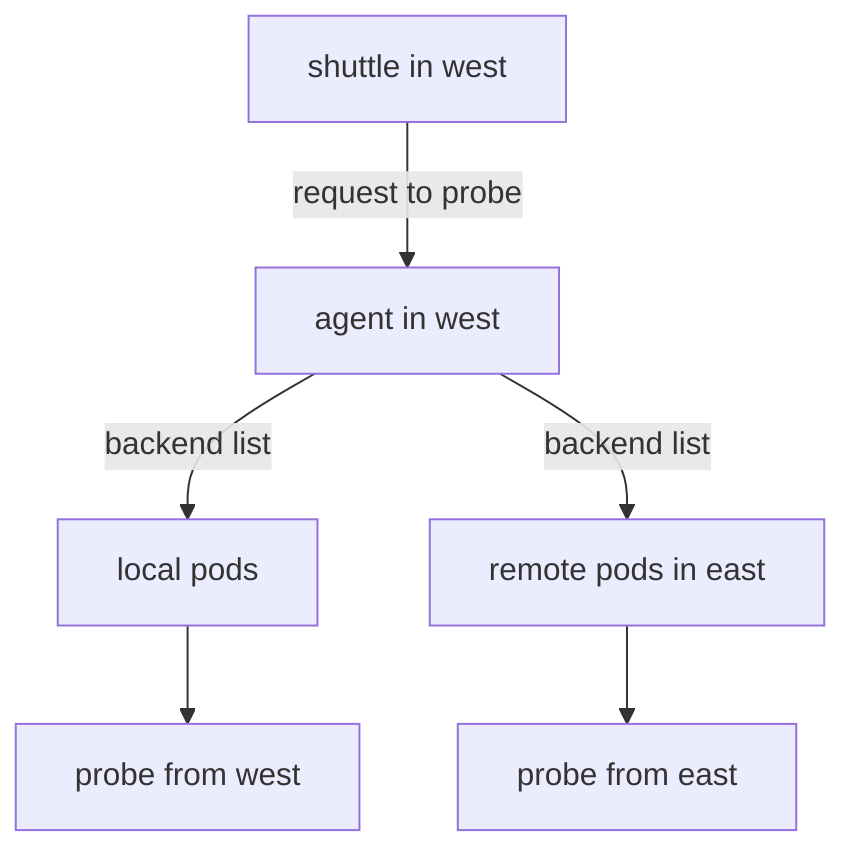

# Global Services And Backend Merging

A Service gives a stable name and a virtual IP address to a changing set of pods. The set comes from a selector and the pods are in the cluster of the Service. When a workload runs in two clusters, each cluster has its own Service with its own pods. A client in one cluster cannot use the pods of the other through the Service name. Global services remove that limit. This part explains the annotation, the rules around it and how Cilium merges backends.

## What makes a service global

A global service is an ordinary Kubernetes Service with one annotation. Cilium reads the annotation `service.cilium.io/global: "true"` and treats the Service as a member of a cluster-wide group. The group is identified by the namespace and the name of the Service. Two Services in different clusters belong to the same group only when both have the same namespace and the same name.

Three conditions apply:

- The Service exists in every cluster that should take part.
- The Service has the annotation in every one of those clusters.
- The Service has compatible ports in every cluster. Cilium does not translate between different port definitions.

A cluster that lacks the Service or the annotation does not take part. That cluster neither receives remote backends nor offers its own.

## How Cilium merges backends

Each agent learns about the Services and endpoints of its own cluster from the Kubernetes API. With Cluster Mesh it also learns the endpoints of the Services of the same name in the remote clusters, which it reads from the remote `clustermesh-apiserver`. It then keeps one list of backends for the Service: the local pods, followed by the remote pods that were shared with it.

Load balancing happens on the node of the client. When a pod sends a request to the Service IP address, the agent picks one backend from the list. For a remote backend the agent sends the packet to the remote pod IP address through the mesh data path. No proxy in the middle changes the address.



The diagram shows that the agent of the client holds one list with local and remote backends and picks among them.

## Sharing and using are separate settings

Each cluster decides two things about a global service. It decides whether it offers its local backends, and it decides to use the remote ones. The annotation `service.cilium.io/shared` controls the first decision. Its default is `true`.

- `shared: "true"`, the default, offers the local backends to other clusters.
- `shared: "false"` keeps the local backends private. The cluster still uses the backends that other clusters share.

The result for two clusters where only `west` sets `shared: "false"` is asymmetric. The clients in `west` see the backends of both clusters. The clients in `east` see only the backends of `east`, because `west` shares nothing. This fits a case in which a cluster is a consumer of a service that another cluster runs and must not be a source of traffic for it.

<!-- astrona:playground:renew -->

## Make a Service global

Open a shell in the playground and save the context names:

```sh
export WEST="$(kubectl config current-context)"
export EAST="$ASTRONA_CLUSTER_EAST_CONTEXT"
```

Without annotations, the `shuttle` of `west` reaches only local pods. Send six requests:

```sh
for attempt in 1 2 3 4 5 6; do kubectl --context "$WEST" -n starfleet exec shuttle -- curl -s --max-time 3 http://probe; done
```

Every reply is `probe from west`. Annotate the Service in both clusters:

```sh
kubectl --context "$WEST" -n starfleet annotate service probe service.cilium.io/global=true --overwrite
kubectl --context "$EAST" -n starfleet annotate service probe service.cilium.io/global=true --overwrite
```

Wait a few seconds and repeat the requests. Count the distinct replies of 30 requests:

```sh
for attempt in $(seq 1 30); do kubectl --context "$WEST" -n starfleet exec shuttle -- curl -s --max-time 3 http://probe; done | sort | uniq -c
```

The result has two lines, one for `probe from east` and one for `probe from west`. The exact counts vary from run to run, because the agent picks the backend for each new connection.

## What you now know

A global service is a Service with the global annotation, with the same name and namespace in every cluster. Each agent merges the local and remote backends and balances across them on the client node. Sharing and using are separate: `shared: "false"` stops a cluster from offering its backends and does not stop it from using others. What is still open is how to prefer local or remote backends and how to deal with a failure.

## Common pitfalls

- Annotating the Service in one cluster only. The other cluster keeps local backends only.
- Different Service names or namespaces in the two clusters. They are then two separate Services.
- Expecting equal counts in a sample of requests. The agent balances connections, and a small sample varies.
- Reading `shared: "false"` as "do not use remote backends". It means "do not offer local backends".

> [!WARNING]
> A global service sends requests to pods in other clusters. Any network policy of the remote cluster that protects those pods must allow the clients of your cluster, or the requests fail for a share of the replies.
