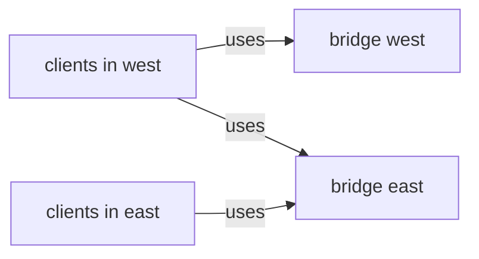

# Control Which Clusters Share Their Backends

A global service is rarely symmetric in practice. A team may run a service in one cluster only and let other clusters consume it. Another team may run a service in two clusters and need one of them to stay private. The annotations `shared` and the Service itself give these shapes. This part sets up three shapes, tests what each cluster sees and reads the backend list that the agent holds.

## Three shapes of a global service

The playground has the Service `bridge` in `starfleet` of both clusters. Each shape below is a combination of annotations on the two Services:

1. Both clusters set `global: "true"`. Each cluster offers and uses all backends. Clients in both clusters see both clusters.
2. Both set `global: "true"`, and `west` also sets `shared: "false"`. The clients in `west` see both clusters. The clients in `east` see `east` only.
3. Only one cluster has the global annotation. The cluster without it keeps local backends only and takes no part in the group.



The diagram shows shape 2: `west` offers nothing, so `east` clients reach `east` only, and `west` clients reach both.

<!-- astrona:playground:renew -->

## Test shape 1

Open a shell in the playground and save the context names:

```sh
export WEST="$(kubectl config current-context)"
export EAST="$ASTRONA_CLUSTER_EAST_CONTEXT"
```

Annotate `bridge` as global in both clusters:

```sh
kubectl --context "$WEST" -n starfleet annotate service bridge service.cilium.io/global=true --overwrite
kubectl --context "$EAST" -n starfleet annotate service bridge service.cilium.io/global=true --overwrite
```

Count the replies from both clients:

```sh
for context in "$WEST" "$EAST"; do
  echo "client in $context"
  for attempt in $(seq 1 30); do kubectl --context "$context" -n starfleet exec shuttle -- curl -s --max-time 3 http://bridge; done | sort | uniq -c
done
```

Each client sees `bridge from east` and `bridge from west`.

## Test shape 2

Stop `west` from sharing its backends:

```sh
kubectl --context "$WEST" -n starfleet annotate service bridge service.cilium.io/shared=false --overwrite
```

Wait a few seconds and run the same loop again. The `shuttle` of `west` still gets both replies, and the `shuttle` of `east` gets `bridge from east` only. `west` kept using the remote backends and stopped offering its own.

## Read the backend list

Each agent holds the merged list. Ask the agent of `west` for the Service list:

```sh
kubectl --context "$WEST" -n kube-system exec ds/cilium -- cilium-dbg service list
```

Find the line of the `bridge` Service IP address. It has the pod addresses of both clusters as backends. Run the same command in `east`: the `bridge` entry lists the `east` pods only.

## Remove the shape

Remove both annotations to return to local backends. A trailing dash removes an annotation:

```sh
kubectl --context "$WEST" -n starfleet annotate service bridge service.cilium.io/global- service.cilium.io/shared-
kubectl --context "$EAST" -n starfleet annotate service bridge service.cilium.io/global-
```

Repeat the loop. Each client sees its own cluster only.

## What you now know

You can build the three shapes of a global service and predict what each cluster sees. The merged backend list in each agent shows the result directly. What is still open is how to prefer local backends when both exist, and how clusters behave when a remote cluster stops answering.

## Common pitfalls

- Reading only one cluster. A `shared: "false"` setting looks fine from `west` and breaks the view of `east`.
- Testing right after the annotation. The agents need a few seconds to update the backend list.
- Using the pod list of the Service as proof. Pod lists show local pods only. Read the agent's service list instead.
- Removing the global annotation from one cluster and expecting the other to keep a mesh-wide service.

> [!WARNING]
> Removing the global annotation moves clients back to local backends at once. If the local pods cannot carry the load, the service fails for those clients.
