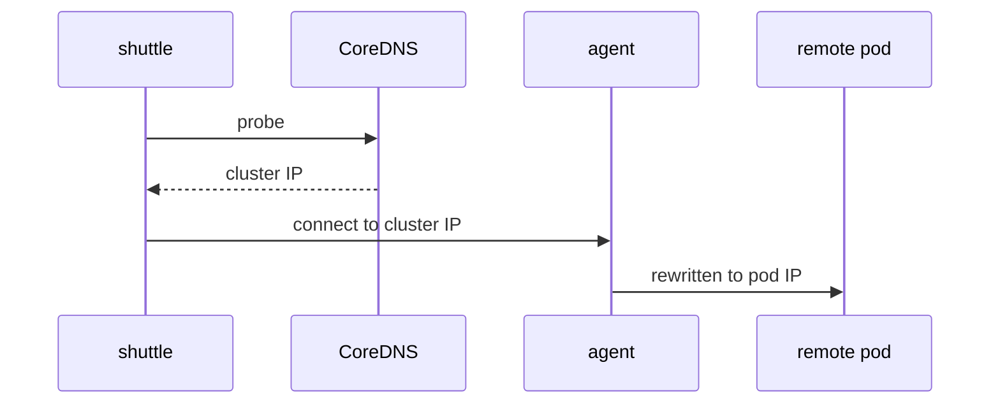

# Follow A Request To A Remote Backend

A client that calls a Service name never sees where the request goes. Two components decide: the DNS server that turns the name into an address, and the Cilium agent that turns that address into a pod. Knowing the split explains why a global service needs no change in DNS, and why a wrong backend list shows up as wrong replies and not as a lookup error. This part follows one request step by step and reads the state that each step leaves.

## Step 1: the name resolves to a local address

The pod sends a DNS query for `probe`, which the Kubernetes DNS server (CoreDNS) answers. CoreDNS knows only the Services of its own cluster. It returns the cluster IP address of the local Service `probe`. A global service changes nothing here. The address belongs to the local Service, and the name stays in the domain `cluster.local`.

This also explains a limit: a name resolves only if a Service with that name exists in the local cluster. A cluster that lacks the Service gets no answer from DNS, even if another cluster has it. The Service must exist in each cluster, with the annotation.

## Step 2: the agent replaces the address with a backend

The pod opens a connection to the cluster IP address. The Cilium agent has attached an eBPF program to the socket of the pod, and the program runs when the application calls connect. It looks up the address and the port in the table of services and picks one backend from the list of that Service. It then rewrites the destination of the connection to the address of that backend. This is socket-level load balancing, and it happens before any packet leaves the pod.

For a global service the list holds local and remote pod addresses together. The program does not care where a backend runs. If the pick is a remote pod, the packet leaves through the mesh data path to the node of that pod.



The diagram shows that DNS returns the local address and the agent chooses the backend at connect time.

<!-- astrona:playground:renew -->

## Read the service table

Open a shell in the playground and save the context names:

```sh
export WEST="$(kubectl config current-context)"
export EAST="$ASTRONA_CLUSTER_EAST_CONTEXT"
```

The playground clusters are connected already. Make `probe` global in both clusters:

```sh
kubectl --context "$WEST" -n starfleet annotate service probe service.cilium.io/global=true --overwrite
kubectl --context "$EAST" -n starfleet annotate service probe service.cilium.io/global=true --overwrite
```

Read the cluster IP address of the Service in `west`:

```sh
kubectl --context "$WEST" -n starfleet get service probe -o jsonpath='{.spec.clusterIP}{"\n"}'
```

Now read the service table of the agent in `west`:

```sh
kubectl --context "$WEST" -n kube-system exec ds/cilium -c cilium-agent -- cilium-dbg service list
```

Find the line whose frontend is the cluster IP address that you just read. It lists four backends: the two `probe` pods of `west` and the two of `east`. The backends of `east` have addresses from the pod range of `east`. If only two backends appear, wait a few seconds and read the table again, because the agent needs time to learn the remote endpoints.

## Prove that DNS is not involved

Request the service twenty times and count the replies:

```sh
for attempt in $(seq 1 20); do kubectl --context "$WEST" -n starfleet exec shuttle -- curl -s --max-time 3 http://probe; done | sort | uniq -c
```

The replies come from both clusters. The name never changed. Only the backend of each connection did, which shows that the agent, not DNS, spreads the load.

## What you now know

CoreDNS resolves the name to the local Service address. The agent replaces that address with a backend at connect time, and a global service puts local and remote pods in the same list. The command `cilium-dbg service list` shows that list on one node. What is still open is which settings of the Service itself the mesh requires.

## Common pitfalls

- Expecting DNS to return the addresses of remote pods. It returns the local cluster IP address.
- Creating the Service in one cluster only. The name does not resolve in the other cluster.
- Reading the service table on a node that does not run the client. Each node has its own table.
- Judging the list right after an annotation change, before the agent has synchronized.

> [!WARNING]
> Existing connections keep their backend. A change of the backend list affects new connections only, so restart the client or open a new connection to test.
