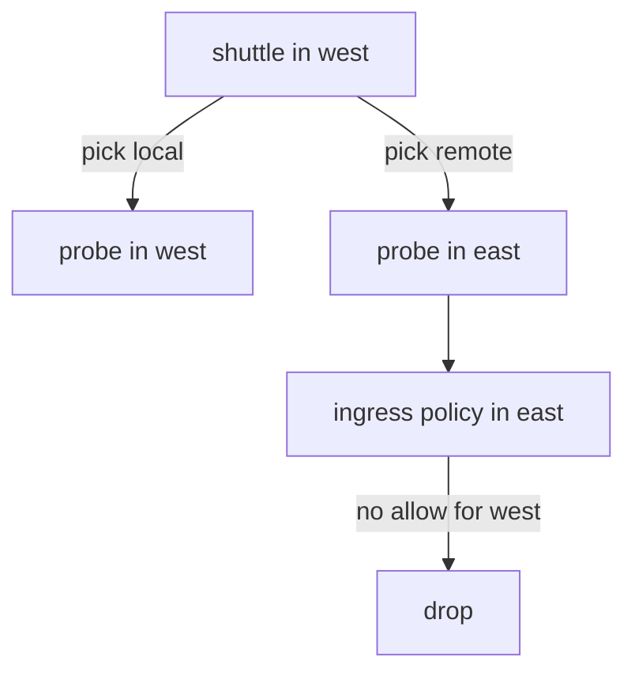

# Global Services And Network Policy

A global service spreads requests over the pods of several clusters, and each cluster can have its own network policy. If the policies disagree, some of the backends accept the client and some drop it. The client then sees timeouts on part of its requests, which is one of the hardest failures to read. This part explains where the policy applies for a global service and shows the failure on purpose.

## Where the decision happens

The agent of the client picks a backend at connect time. After that pick, the connection is an ordinary connection from the client pod to one backend pod. Two policy checks follow.

The egress check runs on the node of the client. It uses the identity of the backend, not the identity of the Service. An egress rule that lists `toEndpoints` therefore matches the labels of the chosen backend pod, including its cluster label. The ingress check runs on the node of the backend. It uses the identity of the client, including its cluster label. The Service object takes no part in either check.

## The failure pattern

Suppose the backends of `probe` run in both clusters and the cluster `east` has an ingress policy that allows only clients of `east`. A client in `west` sends requests to the global Service. The agent picks a local backend for some requests and a remote backend for others. The local ones succeed. The remote ones reach `east`, where the policy drops them, and the client waits until it times out.

The signs are specific. About half of the requests fail, the failing ones take the full timeout, and the failure is the same for every client of `west`. A service with no remote backends would fail for none. That pattern points to a policy on the remote side, not to a broken mesh.



The diagram shows that the same client has two outcomes, depending on which backend the agent picks.

<!-- astrona:playground:renew -->

## Reproduce the failure

Open a shell in the playground and save the context names:

```sh
export WEST="$(kubectl config current-context)"
export EAST="$ASTRONA_CLUSTER_EAST_CONTEXT"
```

The playground clusters are connected. Make `probe` global in both clusters:

```sh
kubectl --context "$WEST" -n starfleet annotate service probe service.cilium.io/global=true --overwrite
kubectl --context "$EAST" -n starfleet annotate service probe service.cilium.io/global=true --overwrite
```

Check that the requests of `west` reach both clusters:

```sh
for attempt in $(seq 1 20); do kubectl --context "$WEST" -n starfleet exec shuttle -- curl -s --max-time 3 http://probe; done | sort | uniq -c
```

Save this as `cnp-probe-east-only.yaml`:

```yaml
apiVersion: cilium.io/v2
kind: CiliumNetworkPolicy
metadata:
  name: probe-east-only
  namespace: starfleet
spec:
  endpointSelector:
    matchLabels:
      app: probe
  ingress:
  - fromEndpoints:
    - matchLabels:
        io.cilium.k8s.policy.cluster: east
```

Apply it in `east`, because that cluster protects its `probe` pods:

```sh
kubectl --context "$EAST" apply -f cnp-probe-east-only.yaml
```

Then check the result. Send the same twenty requests from `west`:

```sh
for attempt in $(seq 1 20); do kubectl --context "$WEST" -n starfleet exec shuttle -- curl -s --max-time 3 http://probe; echo; done | sort | uniq -c
```

The replies from `probe` of `west` still arrive. The remaining lines are empty, because the requests that the agent sent to `east` timed out. The `east` pods answer only clients of their own cluster.

Fix it by allowing the `shuttle` of `west` as well. Edit `cnp-probe-east-only.yaml` so that the selector lists both clusters with an `In` expression on the cluster label, then apply it again:

```yaml
    - matchExpressions:
      - key: io.cilium.k8s.policy.cluster
        operator: In
        values:
        - east
        - west
```

Replace the single `matchLabels` entry of `fromEndpoints` with the lines above and run the `kubectl apply` command again. The empty lines disappear.

## What you now know

Policy checks use the identity of the client and of the chosen backend, not the Service. A policy on one side of a mesh can drop the requests that the agent sends there, and the symptom is a share of timeouts. The cure is a rule on the destination that names every cluster that may call. What is still open is how the preference for a cluster is set, which is the topic of affinity.

## Common pitfalls

- Testing a global service from one cluster only and missing a policy in the other.
- Counting a timeout as proof that the mesh is down, when only one backend side drops traffic.
- Writing the allow rule in the client cluster. Ingress rules apply in the backend cluster.
- Using the Service name in a policy selector. Policies match pod labels.

> [!WARNING]
> Applying a restrictive ingress policy to a global service in one cluster takes its backends away from the other clusters without any error. Check the policies of every cluster that shares a service.
