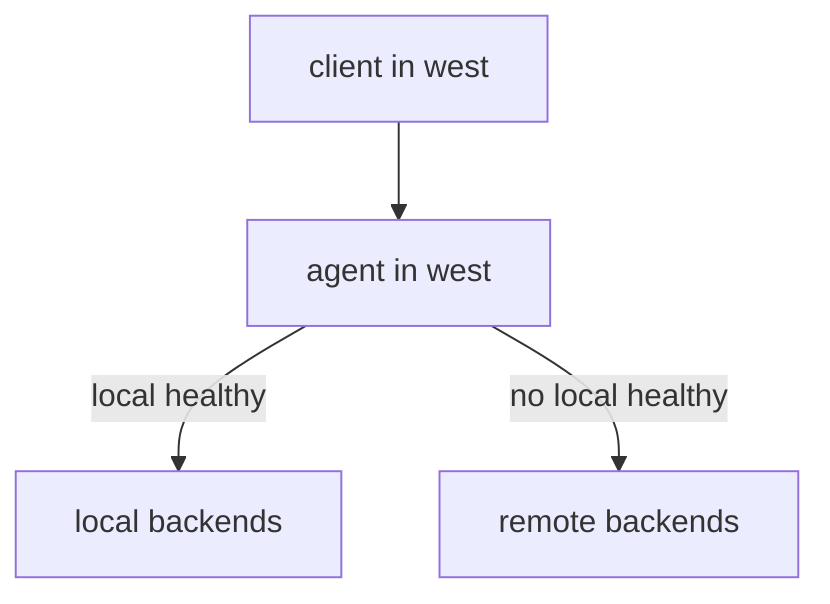

# Service Affinity

A global service that balances across all clusters sends part of every client's requests over the network between clusters. That costs latency and money, and it moves load to the remote cluster. In other cases the opposite is right: a cluster should use a service that runs elsewhere. Cilium lets each cluster state its preference with one annotation. This part explains the three values, the fallback rule and how to see the result.

## The annotation and its three values

The annotation `service.cilium.io/affinity` goes on the Service, in the cluster whose clients you want to steer. It has three values:

- `none` is the default. The agent balances across the backends of all clusters, with no preference.
- `local` prefers the backends of the local cluster. If at least one local backend is healthy, the agent uses only local backends. If none is healthy, the agent uses the remote backends.
- `remote` prefers the backends of the remote clusters. If at least one remote backend is healthy, the agent uses only remote backends. If none is healthy, the agent uses the local backends.

Affinity is a choice of the cluster that carries the annotation. In a mesh of two clusters where `west` sets `local`, the clients of `west` stay in `west`. The clients of `east` keep their own setting, `none` unless `east` also carries an annotation.



The diagram shows the affinity `local`: the agent uses remote backends only when no local backend is healthy.

## How health decides the fallback

The agent knows which backends are ready from the endpoints that the Kubernetes API and the remote cluster report. A backend that fails its readiness probe leaves the list. When the last local backend leaves, the agent switches to the remote backends. When a local backend returns, the agent moves back to local backends for new connections. Existing connections stay on the backend that they already use.

Affinity therefore gives locality with a safety net: a cluster with no healthy pod of a service does not fail while another cluster still has some.

## Which agent view shows the preference

The agent marks the preferred backends in its service list. The option `--clustermesh-affinity` of `cilium-dbg service list` adds the marking, shown as `(preferred)` on the backends. The marking follows the affinity of the Service in the cluster of that agent.

<!-- astrona:playground:renew -->

## Set affinity in the playground

Open a shell in the playground and save the context names:

```sh
export WEST="$(kubectl config current-context)"
export EAST="$ASTRONA_CLUSTER_EAST_CONTEXT"
```

The Services `probe` and `scout` are global in both clusters. Count the replies that the `shuttle` of `west` gets from `probe`:

```sh
for attempt in $(seq 1 30); do kubectl --context "$WEST" -n starfleet exec shuttle -- curl -s --max-time 3 http://probe; done | sort | uniq -c
```

Both `probe from east` and `probe from west` appear. Set the affinity to `local` in `west`:

```sh
kubectl --context "$WEST" -n starfleet annotate service probe service.cilium.io/affinity=local --overwrite
```

Wait a few seconds and run the loop again. Only `probe from west` appears. Now set `remote` on `scout`:

```sh
kubectl --context "$WEST" -n starfleet annotate service scout service.cilium.io/affinity=remote --overwrite
```

Request `scout` from the `shuttle` of `west`. Only `scout from east` appears. Request both Services from the `shuttle` of `east`: the replies still come from both clusters, because `east` has no affinity annotation.

## Read the preferred backends

Ask the agent of `west` for the service list with the affinity marking:

```sh
kubectl --context "$WEST" -n kube-system exec ds/cilium -- cilium-dbg service list --clustermesh-affinity
```

Find the `probe` Service. The `west` backends carry the mark `(preferred)`. Find `scout`: the `east` backends carry it.

## Prove the fallback

Scale the `probe` Deployment of `west` to zero and request the Service:

```sh
kubectl --context "$WEST" -n starfleet scale deployment probe --replicas=0
kubectl --context "$WEST" -n starfleet exec shuttle -- curl -s --max-time 3 http://probe
```

The reply is `probe from east`, because no local backend is left. Scale the Deployment back:

```sh
kubectl --context "$WEST" -n starfleet scale deployment probe --replicas=2
kubectl --context "$WEST" -n starfleet rollout status deployment/probe
```

## What you now know

Affinity is set per cluster and per Service. `local` and `remote` each name a preferred side and fall back to the other side when the preferred side has no healthy backend. What is still open is what the agent does when a remote cluster is not just unhealthy but unreachable.

## Common pitfalls

- Setting affinity in one cluster and expecting the other to follow. Each cluster needs its own annotation.
- Setting `local` and then testing with all local pods stopped. The fallback sends traffic to the remote cluster by design.
- Removing the global annotation to get locality. That removes the remote backends and the safety net.
- Reading the first reply only. Send many requests, because one request shows one backend.

> [!WARNING]
> `local` affinity protects against remote latency and not against a local overload. When the local backends fail, all traffic moves to the remote cluster at once, and that cluster must carry it.
