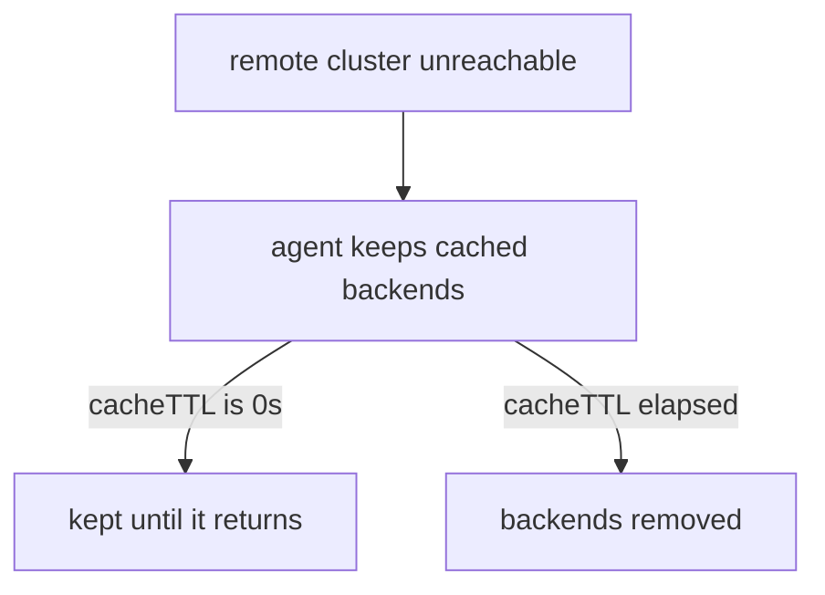

# Unreachable Clusters And Limits

A mesh depends on connections between clusters, and connections fail. A cluster can lose power, the network between clusters can break, or the `clustermesh-apiserver` of a cluster can stop. The agents of the other clusters must then decide what to do with the backends that they learned from that cluster. This part explains the rule, the setting that changes it and the limits of load balancing in a mesh.

## What an agent does when a remote cluster stops answering

Each agent keeps a connection to the `clustermesh-apiserver` of every remote cluster, or to its local kvstoremesh cache. The connection carries updates. When the connection breaks, the agent does not know whether the remote pods are alive. It could drop the remote backends, which would remove capacity that may still work. It could keep them, which would send requests to pods that may have gone.

Cilium keeps them. The agent holds the remote data that it already read and keeps using it until the connection returns. The data is also kept when the agent restarts, because the kvstoremesh cache survives. A request that reaches a remote backend that no longer exists fails and is retried by the client. A short failure of the control path therefore does not cause an outage of traffic that already flows.

## The cache time to live

The Helm value `clustermesh.cacheTTL` decides how long Cilium keeps the cached data of an unreachable cluster. Its default is `0s`, which means the data is never removed. With a positive value, for example `10m`, the agent removes the remote backends when the cluster has been unreachable for that long.

The choice depends on the service. A short time to live removes dead backends earlier and reduces failed requests. A long one keeps capacity during a short network break. Set it knowing which failure is worse.



The diagram shows the two outcomes of an unreachable cluster, which differ only in the value of `clustermesh.cacheTTL`.

## Limits of load balancing

Not every client path is balanced across clusters. Two limits matter for the exam:

- Global NodePort Services balance across clusters only with `kubeProxyReplacement=true` in Cilium. Without it, kube-proxy handles the node port and sees local backends only.
- Clients in the host network, such as a process on a node, balance across clusters only with `kubeProxyReplacement=true`, or with the socket load balancer enabled in the host namespace.

A pod client and a ClusterIP Service are the normal path and have no such limit.

<!-- astrona:playground:renew -->

## Observe an unreachable cluster

Open a shell in the playground and save the context names:

```sh
export WEST="$(kubectl config current-context)"
export EAST="$ASTRONA_CLUSTER_EAST_CONTEXT"
```

The Service `probe` is global in both clusters. Check that `west` sees both clusters:

```sh
for attempt in $(seq 1 30); do kubectl --context "$WEST" -n starfleet exec shuttle -- curl -s --max-time 3 http://probe; done | sort | uniq -c
```

Stop the `clustermesh-apiserver` of `east`:

```sh
kubectl --context "$EAST" -n kube-system scale deployment clustermesh-apiserver --replicas=0
```

Wait about a minute and read the status of `west`:

```sh
cilium clustermesh status --context "$WEST"
```

The status shows that the connection to `east` has a problem. Repeat the requests. The backends of `east` are kept because `clustermesh.cacheTTL` is `0s`, and the pods of `east` still run, so the replies still come from both clusters. Now scale the pods of `east` to zero as well:

```sh
kubectl --context "$EAST" -n starfleet scale deployment probe --replicas=0
```

`west` cannot learn that the backends are gone, because its connection to `east` is down. Some requests then go to addresses that no longer answer and time out. Restore everything:

```sh
kubectl --context "$EAST" -n starfleet scale deployment probe --replicas=2
kubectl --context "$EAST" -n kube-system scale deployment clustermesh-apiserver --replicas=1
cilium clustermesh status --context "$WEST" --wait
```

## What you now know

An agent keeps the remote data that it already has when a cluster becomes unreachable. The value `clustermesh.cacheTTL` ends that keeping after a chosen time, and its default `0s` never ends it. Global NodePort Services and host-network clients need kube-proxy replacement to balance across clusters. What is still open is the standard way of exporting services between clusters.

## Common pitfalls

- Assuming that an unreachable cluster loses its backends at once. The default keeps them.
- Setting a very small `cacheTTL`. A short network break then removes working remote capacity.
- Testing the failure by stopping only the `clustermesh-apiserver` and concluding that traffic stops. Traffic continues on the data path.
- Using a global NodePort Service from the host network without kube-proxy replacement.

> [!WARNING]
> Do not stop the `clustermesh-apiserver` of a production cluster to test failure handling. Other clusters mark it unhealthy and keep stale backends until it returns.
