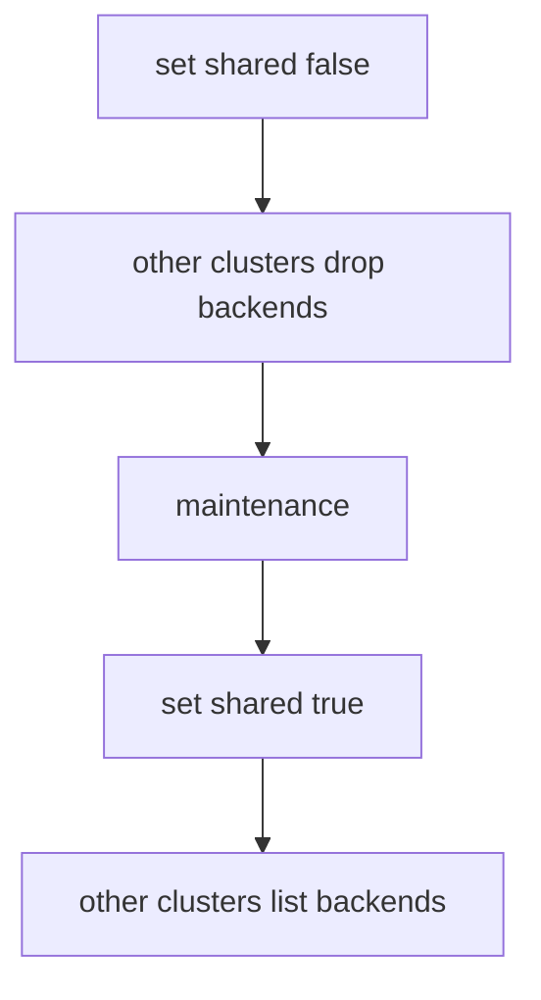

# Drain A Cluster For Maintenance

A cluster that shares its backends is part of the capacity of other clusters. When you upgrade its nodes or its Cilium release, requests from the other clusters that land on it can fail. A planned drain avoids that: you stop other clusters from choosing the backends of the cluster before you touch it. This part gives the order of the steps and the commands that prove each step worked.

## The setting that drains

The annotation `service.cilium.io/shared: "false"` on a global Service tells a cluster to keep its local backends private. The other clusters remove those backends from their lists. The cluster itself keeps using the backends that others share, so its own clients stay served. Setting the annotation back to `"true"` shares the backends again.

This is a better drain than scaling the Deployment to zero. Scaling removes capacity from the cluster itself, while the annotation removes only the outside traffic. It also leaves the pods running, so you can still test them.

## The order of a drain

A drain has four steps, and the order matters:

1. Set `shared: "false"` on every global Service of the cluster that you will touch.
2. Wait until the other clusters no longer list its backends, and check it from a client in another cluster.
3. Do the maintenance in the drained cluster.
4. Set `shared: "true"` again and check that the other clusters list the backends.

Step 2 is the one that teams skip. The annotation change takes a short time to reach the other agents, and a request sent during that time can still reach the cluster. Check the result before you start the work.



The diagram shows the four steps of a drain in order. Each step ends with a check that the previous step took effect.

<!-- astrona:playground:renew -->

## Drain `east` in the playground

Open a shell in the playground and save the context names:

```sh
export WEST="$(kubectl config current-context)"
export EAST="$ASTRONA_CLUSTER_EAST_CONTEXT"
```

The Service `probe` is global in both clusters. Check that requests from `west` reach both clusters:

```sh
for attempt in $(seq 1 20); do kubectl --context "$WEST" -n starfleet exec shuttle -- curl -s --max-time 3 http://probe; done | sort | uniq -c
```

Stop `east` from sharing its backends:

```sh
kubectl --context "$EAST" -n starfleet annotate service probe service.cilium.io/shared=false --overwrite
```

Then check the result. Wait ten seconds, then repeat the requests from `west`:

```sh
for attempt in $(seq 1 20); do kubectl --context "$WEST" -n starfleet exec shuttle -- curl -s --max-time 3 http://probe; done | sort | uniq -c
```

Only `probe from west` appears. Look at the service table of the agent in `west` to confirm that the backends of `east` are gone:

```sh
kubectl --context "$WEST" -n kube-system exec ds/cilium -c cilium-agent -- cilium-dbg service list
```

The line for `probe` now has two backends. The cluster `east` can still call its own pods and the pods of `west`, because the annotation sets what `east` shares, not what it uses. Check that:

```sh
for attempt in $(seq 1 20); do kubectl --context "$EAST" -n starfleet exec shuttle -- curl -s --max-time 3 http://probe; done | sort | uniq -c
```

The replies come from `west` only, because `west` still shares its backends. Now end the drain:

```sh
kubectl --context "$EAST" -n starfleet annotate service probe service.cilium.io/shared=true --overwrite
```

After a short wait the first check from `west` shows both clusters again.

## What you now know

The annotation `shared: "false"` removes the backends of one cluster from the lists of the others and keeps the cluster itself served. A safe drain sets the annotation, checks from another cluster, does the work and then restores the annotation. What is still open is how Cilium decides that a single backend is usable.

## Common pitfalls

- Starting the maintenance right after the annotation change, before the other agents updated.
- Setting the annotation on one Service and forgetting the other global Services of the cluster.
- Scaling the Deployment to zero instead, which removes the cluster's own capacity too.
- Forgetting to set the annotation back to `"true"` after the work.

> [!WARNING]
> Draining one cluster leaves the others with less capacity. Check that the remaining clusters can carry the load before you set the annotation.
