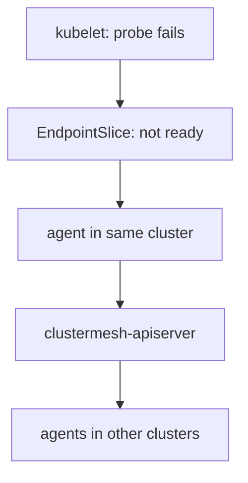

# Backend Readiness And State

A list of backends is only useful if the backends can answer. Kubernetes already tracks which pods are ready, and Cilium builds on that information. In a mesh the question gets one more step: the readiness of a remote pod has to travel to the other clusters. This part explains where the information comes from, how a change spreads and what the agent shows about it.

## Where readiness comes from

The kubelet runs the readiness probe of each container and reports the result to the Kubernetes API. The EndpointSlice controller then marks the address of the pod as ready or not ready in the EndpointSlices of the Service. Cilium reads those EndpointSlices. It uses only the addresses that are ready as active backends.

A pod that is shutting down is a special case. Kubernetes marks its address as terminating. Cilium keeps the backend for existing connections for a while and stops choosing it for new ones, so a rolling update does not cut running requests.

## How a change reaches other clusters

For a shared global service, each cluster writes its backends into its own state, which the `clustermesh-apiserver` serves. When a backend becomes not ready, the agent updates the state. The other clusters read the change through their connection and remove the backend from their lists.

The delay has three parts: the time for the probe to fail, the time for the EndpointSlice to change and the time for the other agents to read the new state. During that delay, a request can still reach the failing pod. A short delay is normal. A long one points to a slow connection to the remote cluster.



The diagram shows the path of a readiness change from the pod to the lists of the other clusters.

<!-- astrona:playground:renew -->

## Watch a backend leave the list

Open a shell in the playground and save the context names:

```sh
export WEST="$(kubectl config current-context)"
export EAST="$ASTRONA_CLUSTER_EAST_CONTEXT"
```

The Service `probe` is global in both clusters. Read the EndpointSlices of `probe` in `east`:

```sh
kubectl --context "$EAST" -n starfleet get endpointslices -l kubernetes.io/service-name=probe
```

The slice lists the addresses of the two pods. Read the backends that the agent of `west` holds for the Service:

```sh
kubectl --context "$WEST" -n kube-system exec ds/cilium -c cilium-agent -- cilium-dbg service list
```

The line of `probe` has four backends. Remove one pod from `east` by scaling the Deployment to one replica:

```sh
kubectl --context "$EAST" -n starfleet scale deployment probe --replicas=1
```

Then check the result. Wait a few seconds and read the service table of `west` again:

```sh
kubectl --context "$WEST" -n kube-system exec ds/cilium -c cilium-agent -- cilium-dbg service list
```

The line of `probe` has three backends now. The change started in `east` and reached the agent in `west` through the mesh. Restore the replica and check that the fourth backend returns:

```sh
kubectl --context "$EAST" -n starfleet scale deployment probe --replicas=2
kubectl --context "$EAST" -n starfleet rollout status deployment probe
```

## What you now know

Cilium uses ready addresses from the EndpointSlices as active backends, and keeps terminating backends for existing connections only. A readiness change travels through the `clustermesh-apiserver` to the other clusters, with a short delay. The service table of the agent shows the result. What is still open is how the agent reads the full state of the load balancer for troubleshooting.

## Common pitfalls

- Using a readiness probe that always succeeds, so failing pods stay in the lists of every cluster.
- Expecting an instant removal. Each step of the path adds some delay.
- Reading the list on a node that has not received the update yet.
- Treating terminating pods as removed. They still serve existing connections.

> [!WARNING]
> Scaling a Deployment in a playground is safe. In production, a scale-down removes capacity in every cluster that uses the Service.
