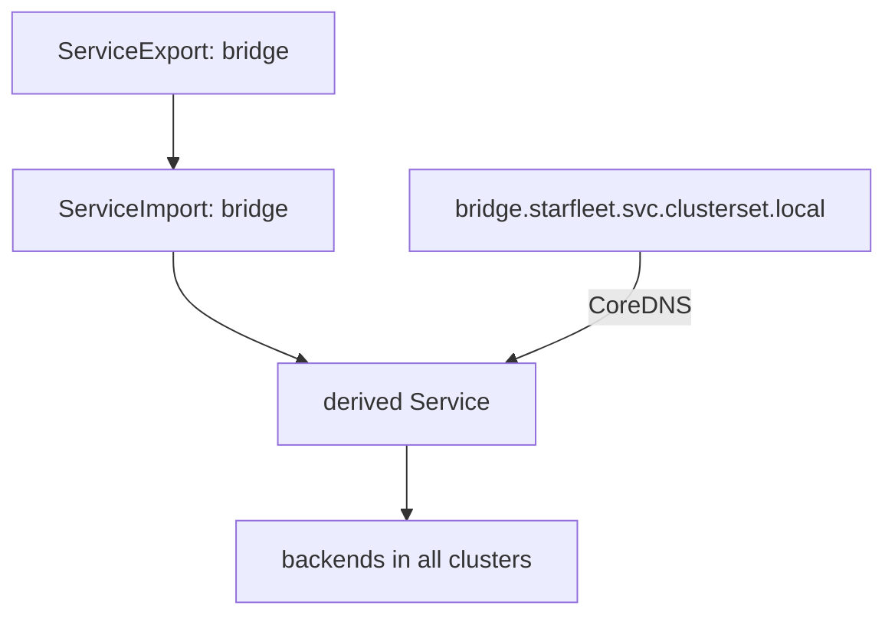

# ServiceExport And Clusterset DNS

The annotation `service.cilium.io/global` works only in Cilium. Software that must run on other networking plugins cannot depend on it. The Kubernetes community describes the same idea with standard resources: a `ServiceExport` offers a Service to other clusters, and a `ServiceImport` represents it on the receiving side. Cilium implements this API on top of Cluster Mesh. This part explains the resources, the names and the settings that turn the feature on.

## The resources

A cluster that has a Service to offer creates a `ServiceExport` with the same name and namespace as the Service. The resource has no fields of its own that you must fill. It says only that this Service is exported. It belongs to the API group `multicluster.x-k8s.io`, version `v1beta1`.

For every exported Service, Cilium creates two objects in each cluster of the mesh:

- a `ServiceImport`, which represents the exported Service in that cluster and lists its ports;
- a derived Service, named `derived-` followed by a hash, whose backends are the pods of all clusters that exported the Service.

Clients do not use the derived Service name. They use a DNS name in the domain `clusterset.local`: `<service>.<namespace>.svc.clusterset.local`. CoreDNS answers that name with the address of the derived Service. The name of a Service in the normal domain `cluster.local` keeps pointing to the local Service only.



The diagram shows the chain from an export to the DNS name, with the derived Service in the middle.

## Settings that turn it on

Two Helm values matter:

- `clustermesh.mcsapi.enabled` turns on the support. Cilium installs the custom resource definitions for `ServiceExport` and `ServiceImport` and runs the controllers that create the imports and the derived Services.
- `clustermesh.mcsapi.corednsAutoConfigure.enabled` lets Cilium change the configuration of CoreDNS so that it answers `clusterset.local`. CoreDNS 1.12.2 or later is required. Without this value you must edit CoreDNS yourself.

Both values go into every cluster of the mesh. A cluster without the support does not import services.

## Exports and labels

The fields `exportedLabels` and `exportedAnnotations` of the export control which labels and annotations of the original Service are copied to the imported Service. Leave them empty for the plain case.

<!-- astrona:playground:renew -->

## Turn on the MCS-API

Open a shell in the playground and save the context names:

```sh
export WEST="$(kubectl config current-context)"
export EAST="$ASTRONA_CLUSTER_EAST_CONTEXT"
```

Upgrade Cilium in both clusters. `--reuse-values` keeps the settings that you made earlier:

```sh
for context in "$WEST" "$EAST"; do
  cilium upgrade --context "$context" --version v1.20.4 --reuse-values \
    --set clustermesh.mcsapi.enabled=true \
    --set clustermesh.mcsapi.corednsAutoConfigure.enabled=true --wait
  kubectl --context "$context" -n kube-system rollout restart deployment/cilium-operator
  kubectl --context "$context" -n kube-system rollout status deployment/cilium-operator --timeout=300s
done
```

Check that the new resource kind exists:

```sh
kubectl --context "$WEST" get crd serviceexports.multicluster.x-k8s.io serviceimports.multicluster.x-k8s.io
```

## Export a Service

Save this as `serviceexport-bridge.yaml`:

```yaml
apiVersion: multicluster.x-k8s.io/v1beta1
kind: ServiceExport
metadata:
  name: bridge
  namespace: starfleet
```

Apply it in both clusters:

```sh
kubectl --context "$WEST" apply -f serviceexport-bridge.yaml
kubectl --context "$EAST" apply -f serviceexport-bridge.yaml
```

Then check the result. Read the imports and the Services in `starfleet`:

```sh
kubectl --context "$WEST" -n starfleet get serviceimport
kubectl --context "$WEST" -n starfleet get service
```

The listing has a `ServiceImport` named `bridge` and a derived Service whose name starts with `derived-`.

## Request the clusterset name

Wait for CoreDNS to restart and request the name:

```sh
kubectl --context "$WEST" -n kube-system rollout status deployment/coredns --timeout=300s
for attempt in $(seq 1 30); do kubectl --context "$WEST" -n starfleet exec shuttle -- curl -s --max-time 3 http://bridge.starfleet.svc.clusterset.local; done | sort | uniq -c
```

Both `bridge from east` and `bridge from west` appear.

## What you now know

The MCS-API describes cross-cluster services with a `ServiceExport`, a `ServiceImport` and the DNS domain `clusterset.local`. Cilium creates the imports and the derived Service, and CoreDNS answers the clusterset name when the two Helm values are on. What is still open is what happens when two clusters export the same name with different definitions.

## Common pitfalls

- Enabling the support in one cluster only. The other cluster does not import.
- Using an older CoreDNS than 1.12.2 with the automatic configuration.
- Requesting `bridge.starfleet.svc.cluster.local` and expecting remote backends. That name is local.
- Exporting from one cluster and expecting both clusters to answer. Every cluster with backends needs its own export.

> [!WARNING]
> Turning on `corednsAutoConfigure` changes the configuration of CoreDNS in the cluster. Check how your platform manages CoreDNS before you enable it on a shared cluster.
