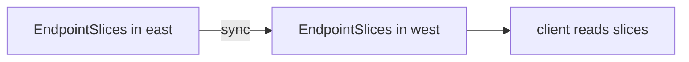

# Conflicts And EndpointSlice Synchronization

A shared name can mean two different things in two clusters. A team may export `bridge` from one cluster with port 80 and another team may export `bridge` from a second cluster with port 8080. The API needs a rule for this case. Separately, some clients do not use Service IP addresses at all. They read EndpointSlices, the Kubernetes objects that list the pod addresses of a Service. This part explains the conflict rule and the synchronization of EndpointSlices.

## Conflicts between exports

The imported Service must have one definition for the whole mesh. When the exports of one name disagree, the clusters have a conflict. Typical differences are the ports, the Service type or the session affinity.

Cilium resolves a conflict in favor of the oldest export. The definition of the cluster whose `ServiceExport` has the earliest creation time becomes the definition of the import. The exports that disagree are marked with a condition and are not used for the conflicting values. Clients keep working with the winning definition.

The result is stable but can surprise a team that created its export later. The remedy is to make the Service definitions match, and not to delete the oldest export.

There is a second rule about names. The per-cluster domain name is not allowed as a clusterset name. A Service cannot be exported under a name that would collide with the local cluster domain.

## Where the imported Service gets its labels

The imported Service gets only the labels and annotations that the export lists in `exportedLabels` and `exportedAnnotations`. A tool that selects Services by a label must find it on the import, so list that label in the export.

## EndpointSlice synchronization

A Service has a matching set of EndpointSlice objects in its own cluster. A client that reads EndpointSlices, such as a headless Service client or a monitoring tool, sees local pods only, even when the Service is global. Cilium can copy the EndpointSlices of a global service into the other clusters.

The annotation `service.cilium.io/global-sync-endpoint-slices` turns this on for a Service. It is a beta feature. It is on by default for headless global Services. The Helm value `clustermesh.enableEndpointSliceSynchronization` turns on the controller that does the copy.



The diagram shows that the slices of a Service in one cluster appear in the other cluster, so a client that reads slices sees remote pods.

<!-- astrona:playground:renew -->

## Read the slices of a global service

Open a shell in the playground and save the context names:

```sh
export WEST="$(kubectl config current-context)"
export EAST="$ASTRONA_CLUSTER_EAST_CONTEXT"
```

The Service `bridge` has an EndpointSlice in each cluster. Read the pod addresses in `west`:

```sh
kubectl --context "$WEST" -n starfleet get endpointslices -l kubernetes.io/service-name=bridge
```

The listing has the local slice and nothing from `east`. Turn on the synchronization for `bridge` in both clusters. The controller must be on, so enable the Helm value first:

```sh
cilium upgrade --context "$WEST" --version v1.20.4 --reuse-values --set clustermesh.enableEndpointSliceSynchronization=true --wait
cilium upgrade --context "$EAST" --version v1.20.4 --reuse-values --set clustermesh.enableEndpointSliceSynchronization=true --wait
```

Then annotate the Services:

```sh
kubectl --context "$WEST" -n starfleet annotate service bridge service.cilium.io/global=true service.cilium.io/global-sync-endpoint-slices=true --overwrite
kubectl --context "$EAST" -n starfleet annotate service bridge service.cilium.io/global=true service.cilium.io/global-sync-endpoint-slices=true --overwrite
```

Read the slices in `west` again:

```sh
kubectl --context "$WEST" -n starfleet get endpointslices -l kubernetes.io/service-name=bridge
```

The listing now has a slice for the pods of `east` as well.

## Provoke a conflict

The MCS-API must be on in both clusters for this step. Save this as `serviceexport-bridge.yaml`:

```yaml
apiVersion: multicluster.x-k8s.io/v1beta1
kind: ServiceExport
metadata:
  name: bridge
  namespace: starfleet
```

Apply it in `west` first and in `east` second, so that the export of `west` is the older one:

```sh
kubectl --context "$WEST" apply -f serviceexport-bridge.yaml
kubectl --context "$EAST" apply -f serviceexport-bridge.yaml
```

Then change the port of the Service in `east`:

```sh
kubectl --context "$EAST" -n starfleet patch service bridge --type merge -p '{"spec":{"ports":[{"port":8080,"targetPort":5678}]}}'
```

Read the export conditions in `east`:

```sh
kubectl --context "$EAST" -n starfleet get serviceexport bridge -o yaml
```

The status of the newer export reports the conflict. Restore the port 80 afterwards.

## What you now know

Cilium resolves conflicting exports in favor of the oldest one, so an import has one definition. EndpointSlice synchronization copies the slices of a global service to the other clusters, for clients that read slices and not Service IP addresses. You can now describe both ways of discovering services across clusters, the annotations and the standard API.

## Common pitfalls

- Creating a second export with a different port and expecting it to win. The oldest export wins.
- Reading EndpointSlices to learn whether a global service works. Without the synchronization, only local pods appear.
- Turning on the annotation without the controller value. The slices are not copied.
- Forgetting to restore the port after a conflict test.

> [!WARNING]
> A conflict is not reported to the clients. They keep working with the winning definition, so a wrong port in a newer export looks like a missing backend. Read the export conditions when a cluster seems absent from the answers.
