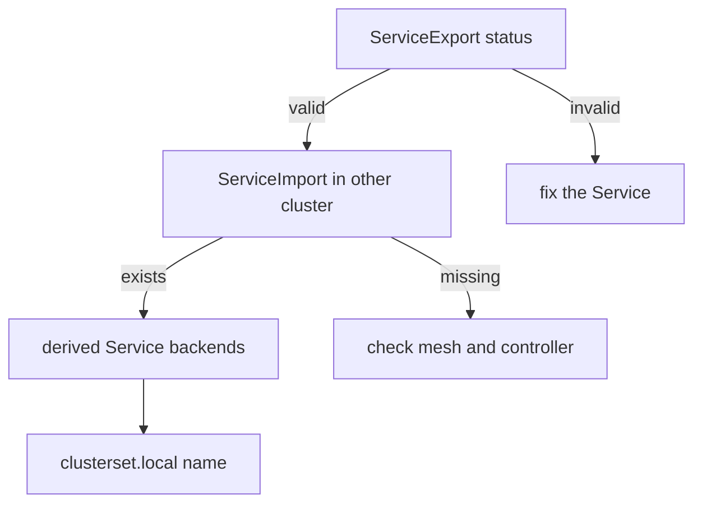

# The MCS-API Objects And Their Status

A `ServiceExport` is a request, and a request can fail. The clusters must agree on the definition, the controllers must create the imports and CoreDNS must answer the new name. When one step fails, the name does not resolve, and the client sees only a DNS error. This part follows the objects that the API creates, reads their status and shows which object to read for which symptom.

## Three objects, three owners

Each object in the chain has a different owner:

- The `ServiceExport` belongs to the team. It lives in the cluster that offers the Service, and it has the same name and namespace as the Service.
- The `ServiceImport` belongs to the controller of the API. Cilium creates one in every cluster of the mesh for each exported Service. It holds the type and the ports of the imported Service.
- The derived Service belongs to Cilium too. It is the Service that gets a cluster IP address in each cluster and has the pods of all exporting clusters as backends.

The standard API group is `multicluster.x-k8s.io`. The `ServiceExport` and the `ServiceImport` are custom resources, so a cluster has them only when the support is on and their definitions are installed.

## Reading the status of an export

A `ServiceExport` reports its state in `status.conditions`. The standard conditions are:

- `Valid`, which is true when the export refers to an existing Service that can be exported.
- `Conflict`, which is true when the exports of the same name disagree, for example in their ports.

An export whose `Valid` condition is false has an error, such as a missing Service or an unsupported Service type. An export with `Conflict` true is in the situation in which the oldest export wins. Read the conditions before you read logs: they usually name the cause.

## Which object to read for which symptom

The chain tells where to look. If `kubectl get serviceexports` shows nothing, the support is off or the export is in the wrong namespace. If the export exists and is valid but no `ServiceImport` exists in the other cluster, the connection between the clusters or the controller is at fault. If the import exists but the name does not resolve, CoreDNS is not set up for `clusterset.local`. If the name resolves but requests fail, look at the backends of the derived Service.



The diagram shows the order of the checks, from the export to the name, and what a failure at each step means.

<!-- astrona:playground:renew -->

## Read the objects in the playground

Open a shell in the playground and save the context names:

```sh
export WEST="$(kubectl config current-context)"
export EAST="$ASTRONA_CLUSTER_EAST_CONTEXT"
```

Turn on the support in both clusters and let Cilium configure CoreDNS:

```sh
for context in "$WEST" "$EAST"; do
  cilium upgrade --context "$context" --version v1.20.4 --reuse-values \
    --set clustermesh.mcsapi.enabled=true \
    --set clustermesh.mcsapi.corednsAutoConfigure.enabled=true
done
```

List the API resources of the group. They exist only after the upgrade:

```sh
kubectl --context "$WEST" api-resources --api-group=multicluster.x-k8s.io
```

The list shows `serviceexports` and `serviceimports`. Save this as `serviceexport-bridge.yaml`:

```yaml
apiVersion: multicluster.x-k8s.io/v1beta1
kind: ServiceExport
metadata:
  name: bridge
  namespace: starfleet
```

Apply it in `east`:

```sh
kubectl --context "$EAST" apply -f serviceexport-bridge.yaml
```

Then check the result. Read the export and its conditions in `east`:

```sh
kubectl --context "$EAST" -n starfleet get serviceexport bridge -o jsonpath='{range .status.conditions[*]}{.type}={.status}{"\n"}{end}'
```

The line `Valid=True` means that the export refers to a usable Service. Now read the import in `west`, where nobody created an export:

```sh
kubectl --context "$WEST" -n starfleet get serviceimport bridge
```

The import exists in `west`, because the controller creates it in every cluster of the mesh. Last, list the derived Service:

```sh
kubectl --context "$WEST" -n starfleet get services | grep derived
```

If a command returns nothing, wait ten seconds and run it again, because the controllers need time to create the objects.

## What you now know

The `ServiceExport` belongs to the team, and the `ServiceImport` and the derived Service belong to Cilium. The conditions `Valid` and `Conflict` of the export give the first answer when something fails. The order export, import, derived Service and DNS name is the order in which to check. What is still open is when to choose this API over a global service.

## Common pitfalls

- Creating an export in a namespace where no Service of the same name exists.
- Looking for the import in the cluster that exports, instead of the cluster that consumes.
- Reading CoreDNS logs before reading the status of the export.
- Expecting the export to work after only one cluster turned the support on.

> [!WARNING]
> The upgrade command above restarts Cilium components in both clusters. Run it on a playground, and keep `--reuse-values` so that the mesh settings stay.
