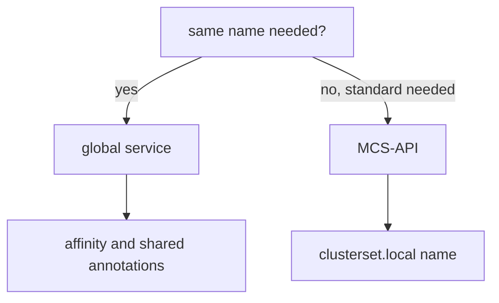

# Choose Between Global Services And The MCS-API

Cilium offers two ways to use one Service in several clusters: the annotation `service.cilium.io/global` and the Multi-Cluster Services API (MCS-API). Both end with a Service that has backends in more than one cluster, but they differ in the way a client finds the service and in who controls the sharing. Choosing between them is a design decision, and the choice is easy to get wrong when only one of the two is known. This part compares them, then works through four cases.

## What differs

The two methods differ in four points:

- **Opt-in.** A global service needs an annotation on a Service in every cluster. The MCS-API needs a `ServiceExport` in each cluster that offers the Service. Clusters that only consume need no object of their own, because Cilium creates the import there.
- **Name.** A global service keeps the normal name, `probe.starfleet.svc.cluster.local`, so existing clients work without a change. The MCS-API uses a new name, `bridge.starfleet.svc.clusterset.local`, so clients must change to use it, and the local name keeps pointing to the local Service.
- **Standard.** The annotation is Cilium-specific. The MCS-API is a Kubernetes community standard that other implementations support, so a workload that uses it keeps working if the networking plugin changes.
- **Load balancing options.** Affinity annotations (`local`, `remote`, `none`) and the `shared` annotation control a global service. The MCS-API uses the derived Service, and the controls differ from those of the annotations.

Both methods depend on a working mesh, on matching Service names and namespaces, and on compatible ports.

## Four cases

Case one: an existing application already calls `probe` by its short name, and the team wants it to fail over to another cluster. A global service fits, because the name does not change.

Case two: a platform team publishes a shared `bridge` service for many teams and wants it to run on any networking plugin. The MCS-API fits, because it is a standard and the name `clusterset.local` marks the service as a multi-cluster service.

Case three: a team needs the local cluster to prefer its own backends and use remote ones only on failure. A global service with `affinity: local` fits, because that control exists there.

Case four: a client must tell a local Service from the multi-cluster Service by its name. The MCS-API fits, because both names exist side by side.



The diagram shows the first question to ask. Whether clients can change the name decides most cases.

## Using both

The two methods do not exclude each other on different Services. One cluster can run a global `probe` and an exported `bridge`. Do not use both for the same Service, because two mechanisms would then manage its backends, and the behaviour is hard to predict.

<!-- astrona:playground:renew -->

## Compare the names in the playground

Open a shell in the playground and save the context names:

```sh
export WEST="$(kubectl config current-context)"
export EAST="$ASTRONA_CLUSTER_EAST_CONTEXT"
```

Make `probe` a global service in both clusters:

```sh
kubectl --context "$WEST" -n starfleet annotate service probe service.cilium.io/global=true --overwrite
kubectl --context "$EAST" -n starfleet annotate service probe service.cilium.io/global=true --overwrite
```

Request the short name from the `shuttle` of `west` and count the replies:

```sh
for attempt in $(seq 1 20); do kubectl --context "$WEST" -n starfleet exec shuttle -- curl -s --max-time 3 http://probe; done | sort | uniq -c
```

The replies come from both clusters under the ordinary name. This is what a global service gives an application that cannot change its configuration. To compare, the MCS-API name of the `bridge` Service works only after the support is enabled in both clusters and `bridge` is exported. Without that, the request below fails to resolve the name:

```sh
kubectl --context "$WEST" -n starfleet exec shuttle -- curl -s --max-time 3 http://bridge.starfleet.svc.clusterset.local
```

The command prints nothing, or an error about the name, because CoreDNS does not know the domain `clusterset.local` yet. That is the visible difference: a global service needs no new name, and the MCS-API needs the support, an export and the new name.

## What you now know

A global service keeps the local name and uses Cilium annotations. The MCS-API adds a standard export object and the name `clusterset.local`. Choose by asking whether clients can change their names and whether the workload must be portable. What is still open is how to keep such a setup working for a long time, which depends on how you check it.

## Common pitfalls

- Choosing the MCS-API for an application that cannot change its name.
- Expecting affinity annotations to control an imported Service.
- Using both methods for one Service.
- Forgetting that every cluster must turn the MCS-API support on.

> [!WARNING]
> The request to `clusterset.local` in this page is expected to fail when the support is off. A failure there does not mean the mesh is broken.
