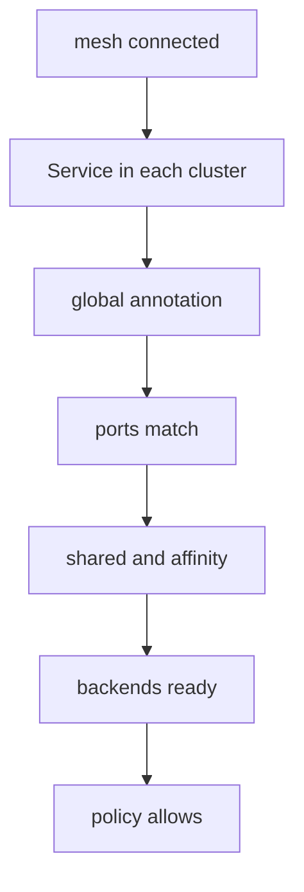

# A Checklist For A Service That Does Not Balance

A global service can fail in quiet ways. Every request succeeds, but all of them go to one cluster. Or most requests succeed and some time out. The cause is almost never the mesh itself. It is one of a few settings on the Service, the pods or the policy. This part gives the checks in the order that finds the cause fastest, and runs the first check in the playground.

## The checks

Each check removes one possible cause. Run them in this order.

1. The mesh is connected. Run `cilium clustermesh status` and confirm that the remote cluster has connected agents.
2. The Service exists in every cluster with the same name and the same namespace. A global service is matched by name and namespace.
3. The annotation `service.cilium.io/global: "true"` is set on the Service in every cluster. A cluster without the annotation does not share its backends and does not use remote ones.
4. The ports match. The port numbers and protocols of the Service must be the same in each cluster, or the backends of that cluster are not merged.
5. The `shared` annotation is not `"false"` on the cluster whose backends are missing. With `service.cilium.io/shared: "false"` a cluster uses remote backends but does not offer its own.
6. The `affinity` annotation matches what you expect. With `local` and a healthy local backend, remote backends receive no requests, and this is correct behaviour.
7. The backends are ready. A pod that is not Ready is not a backend.
8. No network policy drops the traffic from the other cluster.



The diagram shows the order. Stop at the first check that fails.

## Which part does the work

The Kubernetes control plane keeps the Service and the EndpointSlices of the local cluster. The Cilium agent reads the annotation and merges the local backends with the backends it learned from the remote cluster through the mesh. The agent writes the merged list into an eBPF map on the node. A pod that connects to the Service address is steered to one backend by the eBPF program, not by `kube-proxy`. Checks 2 to 6 look at what the agent reads. Check 7 looks at what Kubernetes reports. Check 8 looks at what the datapath enforces.

<!-- astrona:playground:renew -->

## Run the first checks in the playground

Open a shell in the playground and save the context names:

```sh
export WEST="$(kubectl config current-context)"
export EAST="$ASTRONA_CLUSTER_EAST_CONTEXT"
```

Check the mesh, then read the three annotations of `probe` in each cluster:

```sh
cilium clustermesh status --context "$WEST"
for context in "$WEST" "$EAST"; do
  kubectl --context "$context" -n starfleet get service probe -o jsonpath='{.metadata.annotations}{"\n"}'
done
```

Both clusters show `service.cilium.io/global` set to `true`. Now count the replies from `west`:

```sh
for attempt in $(seq 1 20); do kubectl --context "$WEST" -n starfleet exec shuttle -- curl -s --max-time 3 http://probe; done | sort | uniq -c
```

Replies from both clusters appear, so the checks pass. Break check 3 on purpose: remove the annotation in `east` and repeat the count.

```sh
kubectl --context "$EAST" -n starfleet annotate service probe service.cilium.io/global-
sleep 10
for attempt in $(seq 1 20); do kubectl --context "$WEST" -n starfleet exec shuttle -- curl -s --max-time 3 http://probe; done | sort | uniq -c
```

All replies now come from `west`. The Service in `west` is still global, but `east` no longer shares its backends. Restore the annotation:

```sh
kubectl --context "$EAST" -n starfleet annotate service probe service.cilium.io/global=true --overwrite
```

## What you now know

A global service that does not balance is found by eight ordered checks, from the mesh status down to the network policy. Most causes are an annotation missing in one cluster, mismatched ports or an affinity value that is doing what it was told. What is still open is how to read what the agent itself holds for the Service.

## Common pitfalls

- Looking at policy first, when the annotation on one cluster is missing.
- Treating `affinity: local` with all replies from one cluster as a fault.
- Annotating the Service in one cluster only.
- Using a different port number in each cluster.

> [!WARNING]
> Removing the global annotation in a production cluster changes the backends of the Service at once. Do it only in a playground.
