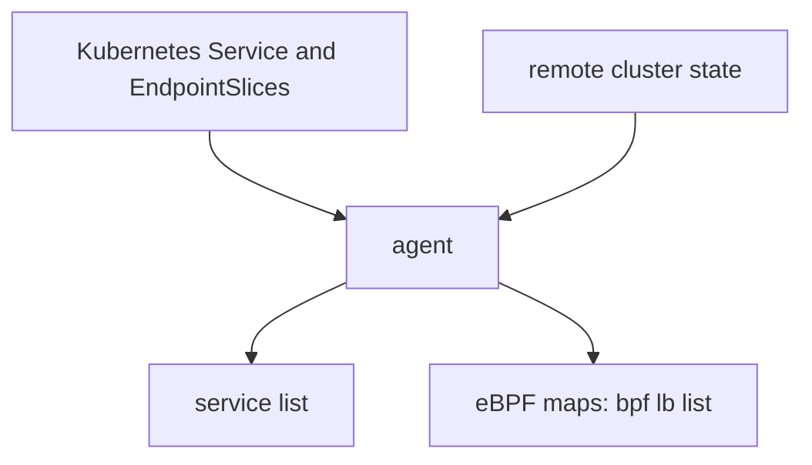

# Read The Service State Of An Agent

The annotations show what you asked for. The agent shows what it did with the request. When replies do not match your expectation, the agent's own table of Services is the evidence, because it lists the backends that the eBPF program really uses. This part shows two commands that read that table and explains how to compare it with Kubernetes.

## The service table

The command `cilium-dbg service list` runs in an agent Pod. It prints one row for each Service address and port that the agent load balances. Each row has an ID, a frontend address, the type and the list of backends with their pod IP addresses and ports. For a global service, the backend list contains pods of every connected cluster, not only the local ones.

The option `--clustermesh-affinity` adds the affinity information. For a Service with `affinity: local` or `remote`, it marks the backends that the agent prefers. With it you can see why a remote backend gets no requests: the local backends are preferred and are healthy.

The command `cilium-dbg bpf lb list` shows the lower level. It prints the entries of the eBPF load balancing maps: the frontend address and port and the backend slots that belong to it. This is the data the kernel program reads for each new connection. A mismatch between this list and `service list` is rare, but the command is the final proof of what the node does.



The diagram shows that the agent merges two inputs into one table and writes the result into the eBPF maps.

## Reading a row

Match the frontend address with the cluster IP of the Service, which `kubectl get service` prints. Count the backends. In a mesh with two pods in each cluster, a global service has four backends. If the count is two, the remote backends are missing. Check the annotation on the Service in each cluster, the ports and the mesh status. If the count is four but replies come from one cluster, read the affinity.

<!-- astrona:playground:renew -->

## Read the table in the playground

Open a shell in the playground and save the context names:

```sh
export WEST="$(kubectl config current-context)"
export EAST="$ASTRONA_CLUSTER_EAST_CONTEXT"
```

Read the cluster IP of `probe` and then find its row in the table of an agent in `west`:

```sh
PROBE_IP="$(kubectl --context "$WEST" -n starfleet get service probe -o jsonpath='{.spec.clusterIP}')"
kubectl --context "$WEST" -n kube-system exec ds/cilium -c cilium-agent -- cilium-dbg service list | grep "$PROBE_IP"
```

The row for `$PROBE_IP:80` lists four backends: two pods of `west` and two of `east`. The agent has one agent Pod per node, and the kind cluster has one node, so `ds/cilium` selects one agent. Set the affinity to `local` and read the table with the affinity option:

```sh
kubectl --context "$WEST" -n starfleet annotate service probe service.cilium.io/affinity=local --overwrite
sleep 5
kubectl --context "$WEST" -n kube-system exec ds/cilium -c cilium-agent -- cilium-dbg service list --clustermesh-affinity | grep "$PROBE_IP"
```

The row still has four backends, and the output marks the local ones as preferred. Now read the lower level:

```sh
kubectl --context "$WEST" -n kube-system exec ds/cilium -c cilium-agent -- cilium-dbg bpf lb list | grep "$PROBE_IP"
```

The command prints the frontend with its backend slots. The exact layout can differ between releases. Restore the default affinity:

```sh
kubectl --context "$WEST" -n starfleet annotate service probe service.cilium.io/affinity-
```

## What you now know

The agent keeps the real list of backends. `cilium-dbg service list` shows it for each Service, the option `--clustermesh-affinity` shows the preference and `cilium-dbg bpf lb list` shows what the kernel program uses. Comparing the backend count with the number of pods you expect tells you whether the problem is in the data the agent has or in the choice of backend. What is still open is how to test the balance without guessing.

## Common pitfalls

- Reading the table of an agent on the wrong node and assuming it applies to all nodes. Each node has its own copy.
- Looking for the Service by name. The table lists addresses, so match the cluster IP.
- Expecting `bpf lb list` output to look the same in every release.
- Forgetting to remove the affinity annotation after a test.

> [!WARNING]
> The option names of `cilium-dbg` can change between releases. If `--clustermesh-affinity` is not accepted, run `cilium-dbg service list --help` and use the options it lists.
