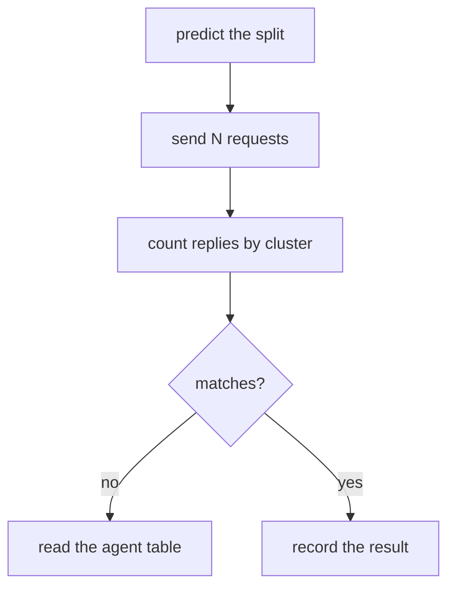

# Test Load Balancing Without Guessing

Three requests that happen to land in the same cluster prove nothing. Load balancing is random by nature, so a test must send enough requests to see a pattern and must say in advance what it expects. This part gives a repeatable test, explains how to choose the number of requests, and shows how to read the result for each affinity setting.

## What to count

Every replica of the example Services answers with one line that names its workload and cluster, for example `probe from east`. A test sends many requests from one client pod, collects the lines, and counts how many came from each cluster. The count is the evidence.

With `affinity` not set, or set to `none`, the agent picks a backend for each new connection from all backends. In a mesh with the same number of pods in each cluster, the expected share is near half for each cluster. With twenty requests, a split between 6 and 14 is normal random variation. With two hundred requests, the split is near 100 each.

Each `curl` command opens a new connection, so each one is balanced separately. A client that keeps one connection open and sends many requests on it, as HTTP keep-alive does, sends all of them to the same backend. This is correct behaviour and a common reason for a skewed result.

With `affinity: local`, the expected result is all requests from the local cluster while a local backend is healthy. With `affinity: remote`, the expected result is all requests from the remote cluster. The fallback is part of the test: remove the preferred backends and the other cluster must answer.



The diagram shows the test loop. Write the prediction before you send the requests.

<!-- astrona:playground:renew -->

## Run the test in the playground

Open a shell in the playground and save the context names:

```sh
export WEST="$(kubectl config current-context)"
export EAST="$ASTRONA_CLUSTER_EAST_CONTEXT"
```

Write a helper function that sends the requests and counts the replies:

```sh
count_replies() {
  for attempt in $(seq 1 "$1"); do
    kubectl --context "$WEST" -n starfleet exec shuttle -- curl -s --max-time 3 http://probe
    echo
  done | sort | uniq -c
}
```

Run it with the default setting. The prediction is a split near half for each cluster:

```sh
count_replies 40
```

Set affinity to `local`. The prediction is that all replies come from `west`:

```sh
kubectl --context "$WEST" -n starfleet annotate service probe service.cilium.io/affinity=local --overwrite
sleep 5
count_replies 40
```

Test the fallback. Scale the local backends to zero. The prediction is that all replies now come from `east`:

```sh
kubectl --context "$WEST" -n starfleet scale deployment probe --replicas=0
sleep 10
count_replies 20
```

Restore both settings:

```sh
kubectl --context "$WEST" -n starfleet scale deployment probe --replicas=2
kubectl --context "$WEST" -n starfleet annotate service probe service.cilium.io/affinity-
kubectl --context "$WEST" -n starfleet rollout status deployment/probe --timeout=120s
```

The three runs show an even split, a local-only result and the fallback to the remote cluster. If a run differs from the prediction, read the service table of the agent before you change anything.

## What you now know

A load balancing test sends enough requests, writes the prediction first and counts replies by cluster. Each new connection is balanced alone, so a client with a persistent connection hides the split. The same test shows the even split, the local preference and the fallback when the preferred backends are gone. What is still open is how many backends a cluster can lose before users notice.

## Common pitfalls

- Drawing a conclusion from five requests.
- Testing with a client that reuses one connection.
- Changing two settings between two runs.
- Forgetting to scale the Deployment back up.

> [!WARNING]
> Scaling a Deployment to zero removes all its backends in that cluster. Run this test only in a playground.
