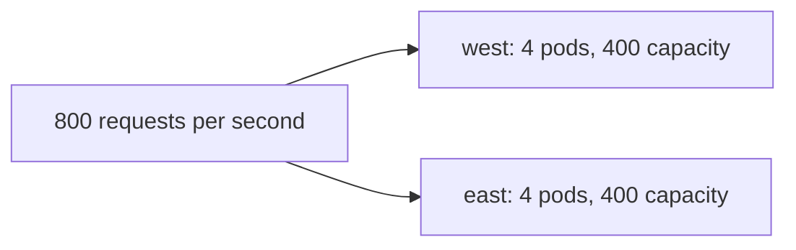

# Capacity And Failure Domains

A global service is often chosen for resilience: if one cluster fails, the other one serves the requests. That promise holds only when the surviving cluster has enough capacity for the extra load and when the failure is of the kind the mesh can hide. This part defines a failure domain, works through a capacity example and lists the failures that a global service does not cover.

## A cluster is a failure domain

A failure domain is a set of components that fail together. A cluster is one failure domain, because one control plane, one set of nodes and one network configuration serve all its pods. Placing backends in two clusters puts them in two failure domains. A fault in one cluster, such as a failed upgrade or a node pool outage, removes only the backends of that cluster.

Cluster Mesh removes the backends of an unreachable cluster from the list after the agent loses the connection and the cached data expires. Until then, some requests can still go to backends that no longer answer. The setting `clustermesh.cacheTTL` controls how long the agent keeps the data of an unreachable cluster. A global service with `affinity: local` keeps traffic in the local cluster and uses remote backends only when no local backend is healthy.

## A capacity example

Suppose two clusters share the load of the `probe` service. Each cluster has four pods and receives half of 800 requests per second, which is 400. Each pod handles 100 requests per second at most. Each cluster runs at 100 percent of its pod capacity.

If `east` fails, `west` receives all 800 requests per second. Its four pods can handle 400. The service is overloaded, and the failure becomes an outage in `west` too. To survive the loss of one cluster, each cluster must hold enough capacity for the full load, that is eight pods of 100 requests per second each, or the load must be reduced during the failure. Planning for failure over two clusters therefore needs about twice the capacity that normal operation uses.



The diagram shows two clusters that each handle half of the load. When one fails, the other cannot handle all of it.

## What a global service does not cover

A global service covers the loss of backends. It does not cover a shared dependency. If both clusters use one database, one identity provider or one external API, the failure of that dependency affects both. It does not cover a mesh outage that is also a network outage: if the clusters cannot reach each other, the agents stop using the remote backends, but local requests keep working. It does not cover a bad release deployed to both clusters at once.

<!-- astrona:playground:renew -->

## Simulate the loss of a cluster

Open a shell in the playground and save the context names:

```sh
export WEST="$(kubectl config current-context)"
export EAST="$ASTRONA_CLUSTER_EAST_CONTEXT"
```

Count the replies, then scale the backends of `east` to zero to simulate a failed cluster:

```sh
for attempt in $(seq 1 20); do kubectl --context "$WEST" -n starfleet exec shuttle -- curl -s --max-time 3 http://probe; echo; done | sort | uniq -c
kubectl --context "$EAST" -n starfleet scale deployment probe --replicas=0
sleep 10
for attempt in $(seq 1 20); do kubectl --context "$WEST" -n starfleet exec shuttle -- curl -s --max-time 3 http://probe; echo; done | sort | uniq -c
```

The first count shows both clusters. The second shows only `west`, and no request fails, because the remote pods were removed from the endpoints before they stopped answering. Check how many backends the agent holds:

```sh
PROBE_IP="$(kubectl --context "$WEST" -n starfleet get service probe -o jsonpath='{.spec.clusterIP}')"
kubectl --context "$WEST" -n kube-system exec ds/cilium -c cilium-agent -- cilium-dbg service list | grep "$PROBE_IP"
```

The row shows two backends, both in `west`. Restore `east`:

```sh
kubectl --context "$EAST" -n starfleet scale deployment probe --replicas=2
kubectl --context "$EAST" -n starfleet rollout status deployment/probe --timeout=120s
```

## What you now know

A cluster is a failure domain, and a global service moves requests away from a cluster whose backends are gone. The surviving cluster must hold enough capacity for the full load, which means about twice the normal capacity for two clusters. Shared dependencies and releases that go to both clusters stay outside the protection of the mesh.

## Common pitfalls

- Sizing each cluster for half of the load and expecting it to survive the other one failing.
- Counting a shared database as redundant because the application is in two clusters.
- Deploying the same change to both clusters at the same time.
- Confusing a drained backend with a failed cluster.

> [!WARNING]
> A simulated failure by scaling to zero is a clean failure. A real cluster outage may leave stale backends in the list until the cached data expires.
